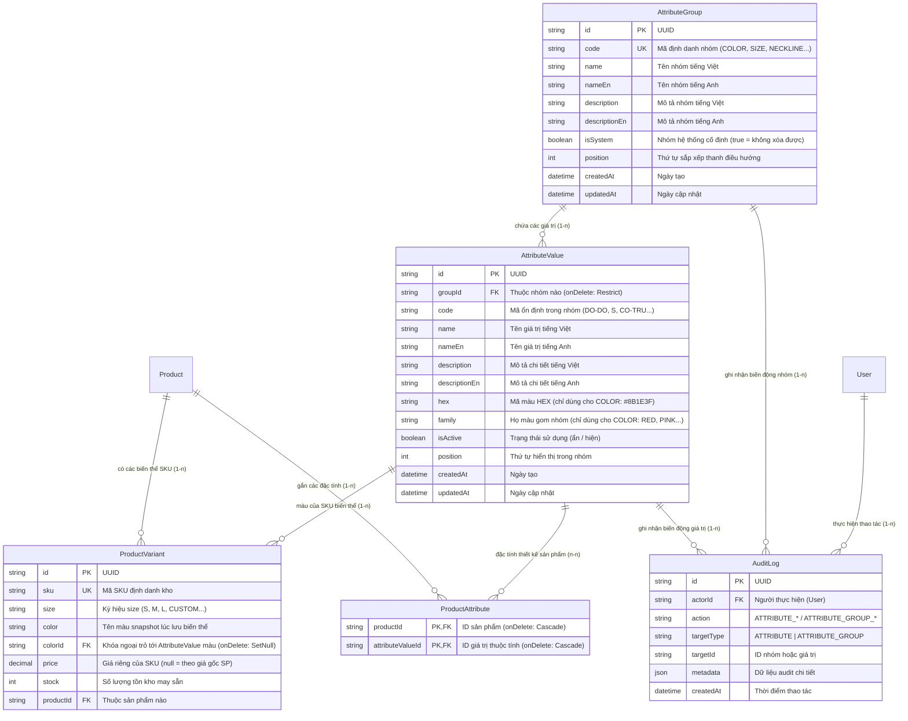

# 📖 Tài liệu Nghiệp vụ & Kiến trúc Cơ sở Dữ liệu — Phân hệ Thuộc Tính Sản Phẩm (Attributes)

> **Dự án:** Thương mại điện tử Áo Dài cao cấp — **Thiên Canh**  
> **Khu vực:** Quản trị nội bộ (`apps/web` — Admin Portal)  
> **Đường dẫn module:** `apps/web/src/features/admin/modules/attributes`  
> **Đường dẫn router:** `/admin/catalog/attributes`  
> **Quyền hạn truy cập (`Permission`):** `MANAGE_INVENTORY` (hoặc vai trò `ADMIN` / Super Admin)  
> **Ngày cập nhật:** 17/11/2026  

---

## 1. Tổng quan Nghiệp vụ Phân hệ Thuộc Tính Sản Phẩm

Trong ngành may mặc thủ công và Áo Dài truyền thống của tiệm **Thiên Canh**, một tác phẩm không chỉ đơn thuần là tên gọi hay giá tiền, mà là sự tổng hòa của màu sắc, kích thước và vô vàn chi tiết tạo tác tinh xảo (kiểu cổ áo, kiểu tay áo, kỹ thuật thêu đính, chiều dài tà, dịp mặc).

Phân hệ **Thuộc tính sản phẩm (Attributes)** trong trang quản trị đóng vai trò là thư viện từ điển chuẩn hóa toàn bộ các thông số kỹ thuật và đặc tính thiết kế, phục vụ cho:
1. **Phát sinh biến thể hàng hóa (SKU Variants)**: Màu sắc và Kích thước là 2 trục biến thể bắt buộc để xác định giá bán lẻ, định danh kho hàng và quản lý tồn kho từng món may sẵn.
2. **Cấu hình đặc tính thiết kế (Design Traits)**: Kiểu cổ áo, kiểu tay, chiều dài tà, họa tiết... giúp khách hàng trên Storefront lọc nhanh sản phẩm theo nhu cầu thẩm mỹ cá nhân hoặc bối cảnh sử dụng.
3. **Chuẩn hóa thông số tư vấn & may đo (Bespoke Specs)**: Định nghĩa chính xác tên gọi, mã kỹ thuật và cách diễn đạt song ngữ (Việt - Anh) trên nhãn may và đơn đặt hàng.

Hệ thống phân tách rạch ròi 2 cấp độ:
- **Nhóm thuộc tính cha (`AttributeGroup`)**: Nhóm phân loại cha (ví dụ: *Màu sắc, Kích cỡ, Kiểu cổ, Chiều dài tà...*).
- **Giá trị thuộc tính con (`AttributeValue`)**: Các giá trị cụ thể trực thuộc nhóm (ví dụ: *Đỏ đô, Vàng hoàng yến, Size M, Cổ đứng 3cm, Tà quét đất...*).

---

## 2. Mô hình Cơ sở Dữ liệu & Mối quan hệ (Prisma Database Models)



### Chi tiết các Bảng & Ràng buộc Toàn vẹn

### 2.1. Bảng `AttributeGroup` (Nhóm thuộc tính)
- **Khóa chính**: `id` (`UUID`).
- **Khóa duy nhất (`@unique`)**:
  - `code`: Chuỗi ký tự in hoa, viết liền hoặc nối bằng gạch dưới/gạch ngang (ví dụ: `COLOR`, `SIZE`, `NECKLINE`, `SLEEVE`, `PATTERN_TECHNIQUE`, `FLAP_LENGTH`, `OCCASION`). Nhóm tự tạo mới: `PHONG-CACH`, `CHAT-LIEU-PHU`...
- **Cờ hệ thống (`isSystem`)**:
  - `isSystem = true`: 7 nhóm gốc cốt lõi tạo bởi hệ thống. **Khóa cứng mã `code` và không cho phép xóa**.
  - `isSystem = false`: Nhóm do quản trị viên tự thêm bổ sung. Cho phép sửa mã và xóa khi nhóm không chứa giá trị nào.
- **Sắp xếp (`position`)**:
  - `@@index([position])`: Tối ưu hóa thứ tự hiển thị của các nhóm trên thanh điều hướng bên trái.

### 2.2. Bảng `AttributeValue` (Giá trị thuộc tính con)
- **Khóa chính**: `id` (`UUID`).
- **Khóa ngoại (`groupId`)**:
  - Liên kết tới `AttributeGroup.id` với `onDelete: Restrict` (không cho phép xóa nhóm cha nếu còn chứa giá trị con).
- **Ràng buộc duy nhất tổng hợp (`@@unique([groupId, code])`)**:
  - Đảm bảo trong cùng một nhóm, mã `code` là duy nhất (ví dụ: trong nhóm `SIZE` chỉ có đúng một size `M`, trong nhóm `COLOR` chỉ có đúng một mã `DO-DO`). Tuy nhiên, mã `M` ở nhóm khác (nếu có) sẽ không bị xung đột.
- **Chỉ mục kết hợp (`@@index([groupId, position])`)**:
  - Tăng tốc tối đa truy vấn lấy toàn bộ giá trị theo nhóm và sắp xếp theo vị trí hiển thị chuẩn xác.
- **Trường đặc thù cho Màu sắc (`hex`, `family`)**:
  - `hex`: Lưu chuỗi mã màu chuẩn 7 ký tự `#RRGGBB` (chỉ áp dụng và bắt buộc khi thuộc nhóm `COLOR`).
  - `family`: Chuỗi định danh một trong 12 họ màu (`ColorFamily`: `RED`, `PINK`, `ORANGE`...) phục vụ gom bộ lọc trên cửa hàng.
- **Trạng thái (`isActive`)**:
  - Cờ bật/tắt (ẩn/hiện). Khi giá trị thuộc tính đã phát sinh SKU sử dụng, quy tắc bảo toàn dữ liệu cấm xóa cứng mà chỉ cho phép chuyển `isActive = false`.

### 2.3. Bảng `ProductAttribute` (Bảng nối n-n Đặc tính thiết kế)
- **Khóa chính kết hợp (`@@id([productId, attributeValueId])`)**:
  - Lưu trữ danh sách các đặc tính thiết kế gắn cho từng sản phẩm (ví dụ: Sản phẩm *Áo dài Tấm Cám* sở hữu các thuộc tính: `CO-TRU-3CM`, `TAY-LO`, `DINH-KET-CUOM`, `TA-CHAM-GOT`, `CUOI-HOI`).
- **Hành vi xóa (`onDelete: Cascade`)**:
  - Khi xóa sản phẩm, các bản ghi nối trong `ProductAttribute` tự động được dọn dẹp sạch sẽ.

### 2.4. Bảng `ProductVariant` (Biến thể SKU thực tế)
- Mỗi SKU bán lẻ liên kết trực tiếp với thuộc tính kích cỡ (`size`) và màu sắc:
  - `colorId`: Trỏ trực tiếp tới `AttributeValue.id` (`onDelete: SetNull`).
  - `color`: Lưu snapshot chuỗi tên màu tại thời điểm khởi tạo biến thể (đảm bảo không bị mất lịch sử trên đơn hàng cũ nếu thuộc tính màu bị sửa đổi).
  - `size`: Ký hiệu size chuẩn khớp với `AttributeValue.code` của nhóm `SIZE`.

---

## 3. Quy chuẩn Nghiệp vụ Chi tiết (Core Business Rules)

### 3.1. Phân loại 2 Trục Thuộc tính: Biến thể SKU vs Đặc tính Thiết kế

Hệ thống phân biệt rõ bản chất của các nhóm thuộc tính thông qua hằng số `VARIANT_GROUP_CODES = ["COLOR", "SIZE"]`:

| Tiêu chí | Nhóm Biến thể SKU (`COLOR`, `SIZE`) | Nhóm Đặc tính Thiết kế (`Design Traits`) |
| :--- | :--- | :--- |
| **Mã nhóm** | `COLOR` và `SIZE` | `NECKLINE`, `SLEEVE`, `PATTERN_TECHNIQUE`, `FLAP_LENGTH`, `OCCASION` + Nhóm tự thêm |
| **Bản chất** | Trục tạo ra mã SKU kho hàng riêng lẻ | Thông số mô tả kỹ thuật, chi tiết nghệ thuật của mẫu áo |
| **Giao diện hiển thị** | Hộp chỉ thêu màu (`ColorPalette`) và Dải thước đo (`SizeTape`) | Thẻ đặc tính đánh số chỉ huy (`TraitGrid`) |
| **Hiển thị sản phẩm** | Nút bấm chọn mua hàng trên Storefront (chọn màu, chọn size) | Bộ lọc tìm kiếm (Faceted Search) và bảng thông số chi tiết sản phẩm |
| **Gắn vào sản phẩm** | Sinh ra từng dòng trong `ProductVariant` | Gắn qua bảng nối `ProductAttribute` |
| **Ràng buộc khi xóa** | Khóa xóa nếu có SKU đang dùng (`skuCount > 0`) | Chỉ được xóa khi không còn sản phẩm nào gắn kèm |

---

### 3.2. Nghiệp vụ Nhóm Màu sắc (`COLOR`) & Hộp Chỉ Thêu Truyền Thống

Màu sắc trong Áo Dài mang đậm dấu ấn ngũ hành và thẩm mỹ cung đình truyền thống. Hệ thống chuẩn hóa trải nghiệm quản lý màu:

#### A. 12 Họ Màu Chuẩn Hóa (`COLOR_FAMILIES`)
Nhằm giúp khách hàng không bị quá tải bởi hàng trăm sắc màu chi tiết (đỏ tươi, đỏ nhung, đỏ gạch, đỏ mận...), hệ thống gom màu vào 12 họ chuẩn:
1. `RED` (#C0262D — Đỏ)
2. `PINK` (#E58FA8 — Hồng)
3. `ORANGE` (#E8833A — Cam)
4. `YELLOW` (#E9C46A — Vàng)
5. `GREEN` (#4F8A5B — Xanh lá)
6. `BLUE` (#3E6FB0 — Xanh dương)
7. `PURPLE` (#7B4FA0 — Tím)
8. `BROWN` (#7A5236 — Nâu)
9. `WHITE` (#F7F4EC — Trắng)
10. `GRAY` (#9CA3AF — Ghi/Xám)
11. `BLACK` (#1C1C1E — Đen)
12. `MULTI` (Đa sắc / Ombre chuyển sắc — hiển thị dải quang phổ `conic-gradient`)

#### B. Thuật toán Gợi ý Họ Màu Tự động (`suggestColorFamily`)
Khi quản trị viên nhập hoặc chọn một mã HEX bất kỳ (ví dụ `#8B1E3F`), hàm chuyển đổi màu sang không gian màu **HSL (Hue, Saturation, Lightness)**:
- Nếu độ bão hòa $S < 0.15$ hoặc độ tương phản màu $D < 0.08$:
  - $L > 0.85 \rightarrow$ Họ `WHITE`
  - $L < 0.20 \rightarrow$ Họ `BLACK`
  - Còn lại $\rightarrow$ Họ `GRAY`
- Tính góc sắc độ $H \in [0^\circ, 360^\circ]$:
  - $H < 15^\circ$ hoặc $H \ge 345^\circ$: $L > 0.70 \rightarrow$ `PINK`, ngược lại $\rightarrow$ `RED`
  - $15^\circ \le H < 45^\circ$: $L < 0.45 \rightarrow$ `BROWN`, ngược lại $\rightarrow$ `ORANGE`
  - $45^\circ \le H < 70^\circ$: $L < 0.35 \rightarrow$ `BROWN`, ngược lại $\rightarrow$ `YELLOW`
  - $70^\circ \le H < 170^\circ \rightarrow$ `GREEN`
  - $170^\circ \le H < 255^\circ \rightarrow$ `BLUE`
  - $255^\circ \le H < 290^\circ \rightarrow$ `PURPLE`
  - $290^\circ \le H < 345^\circ \rightarrow$ `PINK`

#### C. Độ Tương Phản Nhãn Chữ (`readableOn`)
Tự động tính độ chói tương đối theo chuẩn W3C Luminance:
$$\text{Luminance} = \frac{0.299 \times R + 0.587 \times G + 0.114 \times B}{255}$$
- Nếu $\text{Luminance} > 0.6$: Sử dụng chữ màu tối (`#09090B/75`).
- Nếu $\text{Luminance} \le 0.6$: Sử dụng chữ màu sáng (`#FFFFFF/90`).  
Đảm bảo mã HEX luôn luôn đọc rõ nét trên ô màu mà không bị chìm.

#### D. Thư viện Sắc Thái Áo Dài Có Sẵn (`COLOR_PRESETS_BY_FAMILY`)
Cung cấp sẵn danh mục tên gọi truyền thống gắn liền với đời sống Việt Nam để nhân viên chọn nhanh chỉ bằng một click (ví dụ: *Đỏ son, Đỏ nhung, Hồng cánh sen, Hồng phấn, Vàng hoàng yến, Xanh cốm, Xanh ngọc bích, Tím huế, Nâu cánh gián, Trắng ngà, Đen tuyền...*).

---

### 3.3. Nghiệp vụ Nhóm Kích Cỡ (`SIZE`) & Dải Thước Dây May Đo

- **Ký hiệu Size chuẩn**:
  - Size chữ tiêu chuẩn: `XS`, `S`, `M`, `L`, `XL`, `2XL`, `3XL`.
  - Phân loại đặc thù: `FREE_SIZE` (Freesize cho phụ kiện/khăn vấn), `CUSTOM` (Dành riêng cho đơn may đo theo số đo cơ thể).
- **Quy chuẩn hiển thị tên**:
  - Nếu tên giá trị trùng với mã (ví dụ `code: "S"`, `name: "S"`): Giao diện chỉ hiển thị duy nhất một ký hiệu `S`, tránh lặp dạng `S / S`.
  - Nếu tên mang ý nghĩa diễn giải (ví dụ `code: "FREE_SIZE"`, `name: "Free size"`): Hiển thị đồng thời cả mã và tên để giải thích.
- **Thứ tự thước đo (`position`)**:
  - Thứ tự sắp xếp các size trên thanh thước dây trong màn quản trị chính là thứ tự hiển thị tại danh sách chọn size khi khách mua hàng trên Storefront (từ nhỏ đến lớn).

---

### 3.4. Nghiệp vụ Nhóm Đặc Tính Thiết Kế (Design Traits)

Bao gồm 5 nhóm hệ thống mặc định và các nhóm tùy chỉnh do quản trị viên mở rộng:
1. **Kiểu cổ áo (`NECKLINE`)**: Cổ tròn truyền thống, Cổ đứng 2cm, Cổ đứng 3cm, Cổ đứng 4.5cm, Cổ thuyền, Cổ yếm, Cổ tim, Cổ trụ hở...
2. **Kiểu tay áo (`SLEEVE`)**: Tay raglan dài truyền thống, Tay lỡ 3/4, Tay bồng công chúa, Tay cánh tiên, Tay loe, Không tay (sát nách)...
3. **Kỹ thuật hoa văn (`PATTERN_TECHNIQUE`)**: Thêu tay thủ công, Đính kết cườm đá cao cấp, Vẽ cọ thủ công nghệ thuật, Dệt chìm Jacquard, In chuyển nhiệt cao cấp...
4. **Chiều dài tà áo (`FLAP_LENGTH`)**: Tà lửng (cách tân, ngang bắp chân), Tà chấm gót (truyền thống chuẩn), Tà quét đất (dành cho áo dài cưới/dạ tiệc)...
5. **Dịp mặc (`OCCASION`)**: Cưới hỏi & Đính hôn, Lễ tết truyền thống, Dự tiệc sang trọng, Công sở & Giáo viên, Dạo phố & Chụp ảnh...

---

### 3.5. Ràng buộc An Toàn & Bảo Vệ Dữ Liệu Khi Xóa (Safe Deletion Policy)

Để bảo đảm tính toàn vẹn dữ liệu kế toán và kho hàng:
1. **Kiểm tra phát sinh biến thể (`skuCount`)**:
   - Đối với nhóm `COLOR`: Đếm số lượng SKU trong `ProductVariant` có trường `color` khớp tên màu (không phân biệt hoa thường).
   - Đối với nhóm `SIZE`: Đếm số lượng SKU trong `ProductVariant` có trường `size` khớp mã size.
2. **Quy tắc chặn xóa**:
   - Nếu `skuCount > 0`: Nút "Xóa" bị **vô hiệu hóa** hoàn toàn trong menu thao tác. Nếu người dùng cố tình gửi request xóa, Server Action sẽ từ chối và trả mã lỗi `ATTRIBUTE_IN_USE`.
   - **Giải pháp thay thế**: Cho phép "Ẩn" (`isActive = false`). Giá trị bị ẩn sẽ không thể chọn khi thêm sản phẩm/biến thể mới, nhưng toàn bộ lịch sử đơn hàng và sản phẩm cũ vẫn hoạt động bình thường.
3. **Quy tắc xóa Nhóm thuộc tính (`AttributeGroup`)**:
   - Nhóm có cờ `isSystem = true`: **Cấm xóa tuyệt đối** (`ATTRIBUTE_GROUP_SYSTEM_LOCKED`).
   - Nhóm tự thêm (`isSystem = false`): Bắt buộc phải **xóa sạch toàn bộ giá trị con** bên trong trước khi xóa nhóm cha (`ATTRIBUTE_GROUP_NOT_EMPTY`).

---

### 3.6. Cơ chế Sắp Xếp Thứ Tự Hiển Thị (`reorderAttributesAction`)

- Quản trị viên có thể đổi thứ tự hiển thị của các giá trị thuộc tính trong cùng một nhóm thông qua menu "Chuyển lên trên" (`ArrowUp`) hoặc "Chuyển xuống dưới" (`ArrowDown`).
- **Cập nhật lạc quan (Optimistic Update)**: Giao diện ngay lập tức đổi vị trí giá trị để tạo cảm giác mượt mà tức thì cho người dùng.
- **Xử lý phía Server**: Chạy transaction `prisma.$transaction` cập nhật lại toàn bộ trường `position = 0, 1, 2...` theo đúng mảng `orderedIds`.
- **Ràng buộc an toàn tìm kiếm**: Khi người dùng đang gõ từ khóa tìm kiếm (lọc danh sách), nút chuyển thứ tự sẽ bị tự động khóa (`reorderDisabled = true`) để ngăn ngừa sai lệch chỉ mục hiển thị.

---

## 4. Kiến trúc Giao diện Người dùng (UI / UX Architecture)

Giao diện phân hệ Thuộc tính được tổ chức thành cấu trúc **Split View** chuyên nghiệp:

```text
┌────────────────────────────────────────────────────────────────────────────────────────┐
│ [Icon Tags] Danh mục thuộc tính                                   [+ Thêm màu sắc]     │
├─────────────────────────┬──────────────────────────────────────────────────────────────┤
│ THANH CHỌN NHÓM (232px) │ KHU VỰC HIỂN THỊ DỮ LIỆU ĐỘNG (Dynamic Board)                │
│                         │                                                              │
│ BIẾN THỂ SKU            │ Tiêu đề nhóm đang chọn + Mô tả + [Menu ...]                  │
│ • [Icon] Màu sắc    (32)│ ──────────────────────────────────────────────────────────── │
│ • [Icon] Kích cỡ     (8)│ A. Nếu là COLOR:                                             │
│ ─────────────────────── │    • Gom nhóm theo từng họ màu (Họ Đỏ, Họ Hồng, Họ Vàng...)   │
│ ĐẶC TÍNH THIẾT KẾ       │    • Lưới Swatch 4-5 cột, hiển thị mã HEX, tên màu, số SKU   │
│ • [Icon] Kiểu cổ áo  (7)│                                                              │
│ • [Icon] Kiểu tay áo (5)│ B. Nếu là SIZE:                                              │
│ • [Icon] Họa tiết    (6)│    • Dải thước dây may đo hiển thị trực quan vạch chia cm    │
│ • [Icon] Chiều dài tà(3)│    • Bảng chi tiết danh sách size, ký hiệu, số SKU            │
│ • [Icon] Dịp mặc     (5)│                                                              │
│ ─────────────────────── │ C. Nếu là Đặc tính thiết kế (Traits):                        │
│ [+ Thêm nhóm thuộc tính]│    • Lưới thẻ đánh số thứ tự 01, 02... song ngữ VI / EN      │
└─────────────────────────┴──────────────────────────────────────────────────────────────┘
```

### Các Thành phần Giao diện Cốt lõi:
1. `AttributesBoard.tsx`: Container điều phối chính, quản lý state nhóm đang chọn, từ khóa tìm kiếm, điều phối dialog biên tập/xóa.
2. `AttributeValueViews.tsx`: Chứa 3 chế độ xem độc lập tùy biến theo bản chất nhóm:
   - `ColorPalette`: Hiển thị bảng màu chuẩn thẩm mỹ hộp chỉ thêu, hiển thị họ màu, tương phản chữ trên nền màu thông minh.
   - `SizeTape`: Hiển thị thước may đo thợ may với nền CSS `repeating-linear-gradient` mô phỏng vạch chia độ chân thực.
   - `TraitGrid`: Hiển thị danh sách các đặc tính thủ công mỹ nghệ dạng thẻ số hóa.
3. `AttributeEditorDialog.tsx`: Dialog thông minh 2 trong 1 (vừa tạo/sửa nhóm cha, vừa tạo/sửa giá trị con). Tích hợp công tắc chuyển ngôn ngữ VI/EN (`AdminLangSwitch`), Color Picker native, dải 12 chấm màu nhanh và bộ presets màu may mặc cổ truyền.
4. `AttributeDeleteDialog.tsx`: Dialog cảnh báo nguy hiểm trước khi xóa nhóm hoặc xóa thuộc tính.

---

## 5. Cấu trúc Thư mục & Phân bổ Trách nhiệm

```text
apps/web/src/features/admin/modules/attributes/
├── actions/
│   └── attributes.actions.ts         # Server Actions: mutate dữ liệu, revalidate, audit log
├── components/
│   ├── dialog/
│   │   ├── AttributeDeleteDialog.tsx # Dialog xác nhận xóa an toàn
│   │   └── AttributeEditorDialog.tsx # Dialog tạo/sửa nhóm và giá trị thuộc tính
│   ├── AttributeGroupIcon.tsx        # Icon tương ứng với từng mã nhóm hệ thống
│   ├── AttributesBoard.tsx           # Layout bàn làm việc chính (Split View 2 cột)
│   └── AttributeValueViews.tsx       # 3 View chuyên biệt: ColorPalette, SizeTape, TraitGrid
├── queries/
│   └── attributes.queries.ts         # Query đọc Prisma: lấy nhóm, giá trị và thống kê SKU
├── schemas/
│   └── attributes.schemas.ts         # Zod validation schema cho form và Server Action input
├── types/
│   └── attributes.types.ts           # Type definitions (AdminAttributeGroup, AdminAttributeValue...)
├── utils/
│   └── attributeMeta.ts              # Hằng số họ màu, thuật toán HSL, tính tương phản, presets
├── index.ts                          # Barrel export duy nhất của feature module
└── ATTRIBUTES.md                     # Tài liệu nghiệp vụ & kỹ thuật chi tiết
```

---

## 6. Danh mục Mã Phản hồi & Mã Lỗi Nghiệp vụ (`KEYS.md`)

Mọi thông báo thành công và lỗi trả về từ Server Action đều được chuẩn hóa thành **mã KEY viết hoa** (`UPPER_SNAKE_CASE`) để phía Frontend đa ngữ hóa linh hoạt:

| Mã phản hồi / Lỗi | Phân loại | Ý nghĩa nghiệp vụ |
| :--- | :--- | :--- |
| `ATTRIBUTE_CREATED` | Audit Log | Ghi nhận tạo mới một giá trị thuộc tính thành công |
| `ATTRIBUTE_UPDATED` | Audit Log | Ghi nhận cập nhật thông tin giá trị thuộc tính |
| `ATTRIBUTE_DELETED` | Audit Log | Ghi nhận xóa vĩnh viễn một giá trị thuộc tính |
| `ATTRIBUTE_GROUP_CREATED` | Audit Log | Ghi nhận tạo mới một nhóm thuộc tính cha |
| `ATTRIBUTE_GROUP_UPDATED` | Audit Log | Ghi nhận cập nhật nhóm thuộc tính cha |
| `ATTRIBUTE_GROUP_DELETED` | Audit Log | Ghi nhận xóa nhóm thuộc tính cha |
| `ATTRIBUTE_NAME_REQUIRED` | Validation Error | Tên giá trị thuộc tính không được để trống |
| `ATTRIBUTE_CODE_INVALID` | Validation Error | Mã thuộc tính sai định dạng (chỉ chấp nhận `A-Z0-9_-`) |
| `ATTRIBUTE_CODE_TAKEN` | Business Error | Mã thuộc tính đã tồn tại trong nhóm này |
| `ATTRIBUTE_HEX_INVALID` | Business Error | Mã màu không đúng định dạng `#RRGGBB` (bắt buộc khi là màu) |
| `ATTRIBUTE_NOT_FOUND` | Business Error | Không tìm thấy giá trị thuộc tính cần xử lý |
| `ATTRIBUTE_IN_USE` | Business Error | **Giá trị đang có SKU sử dụng, cấm xóa (chỉ được phép ẩn)** |
| `ATTRIBUTE_CREATE_FAILED` | System Error | Lỗi hệ thống khi thêm mới giá trị thuộc tính |
| `ATTRIBUTE_UPDATE_FAILED` | System Error | Lỗi hệ thống khi cập nhật giá trị thuộc tính |
| `ATTRIBUTE_DELETE_FAILED` | System Error | Lỗi hệ thống khi xóa giá trị thuộc tính |
| `ATTRIBUTE_GROUP_NAME_REQUIRED` | Validation Error | Tên nhóm thuộc tính không được để trống |
| `ATTRIBUTE_GROUP_CODE_TAKEN` | Business Error | Mã nhóm thuộc tính đã được sử dụng |
| `ATTRIBUTE_GROUP_NOT_FOUND` | Business Error | Không tìm thấy nhóm thuộc tính cha |
| `ATTRIBUTE_GROUP_SYSTEM_LOCKED` | Business Error | **Nhóm hệ thống cố định, không được phép xóa** |
| `ATTRIBUTE_GROUP_NOT_EMPTY` | Business Error | **Nhóm vẫn còn chứa giá trị con, phải dọn sạch trước khi xóa** |
| `ATTRIBUTE_GROUP_CREATE_FAILED` | System Error | Lỗi hệ thống khi tạo mới nhóm thuộc tính |
| `ATTRIBUTE_GROUP_UPDATE_FAILED` | System Error | Lỗi hệ thống khi cập nhật nhóm thuộc tính |
| `ATTRIBUTE_GROUP_DELETE_FAILED` | System Error | Lỗi hệ thống khi xóa nhóm thuộc tính |
