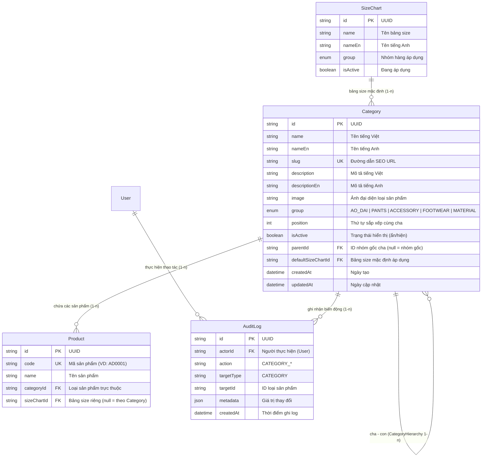
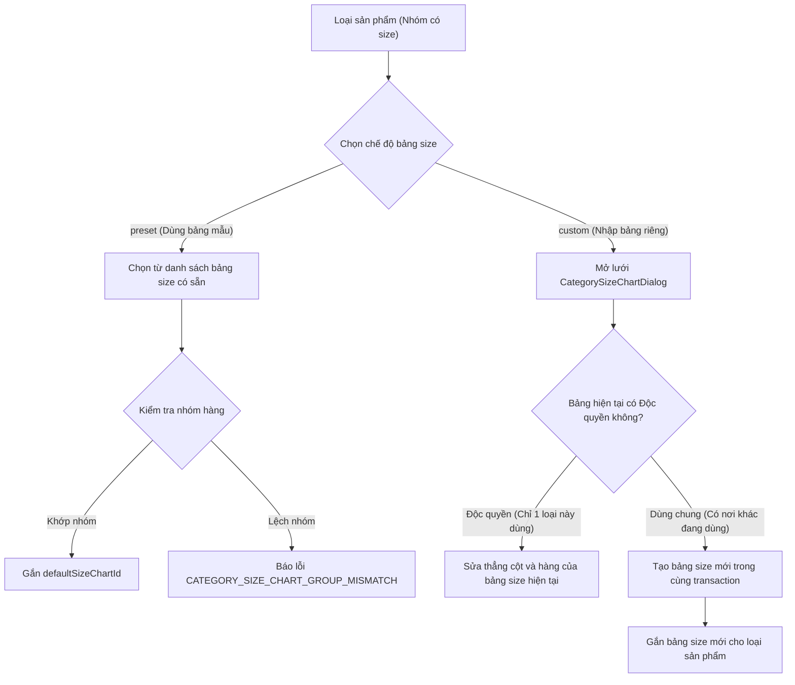

# 📖 Tài liệu Nghiệp vụ & Kiến trúc Cơ sở Dữ liệu — Phân hệ Loại Sản Phẩm (Categories)

> **Dự án:** Thương mại điện tử Áo Dài cao cấp — **Thiên Canh**  
> **Khu vực:** Quản trị nội bộ (`apps/web` — Admin Portal)  
> **Đường dẫn module:** `apps/web/src/features/admin/modules/categories`  
> **Đường dẫn router:** `/admin/catalog/categories` và `/admin/catalog/categories/[id]`  
> **Quyền hạn truy cập (`Permission`):** `MANAGE_INVENTORY` (hoặc vai trò `ADMIN` / Super Admin)  
> **Ngày cập nhật:** 17/11/2026  

---

## 1. Tổng quan Nghiệp vụ Phân hệ Loại Sản Phẩm

Trong tiệm may Áo Dài Thiên Canh, **Loại sản phẩm (Category)** đóng vai trò là xương sống định hình danh mục hàng hóa, phân luồng khách hàng và quyết định các đặc tính kỹ thuật cốt lõi (may đo, chọn size, bảng thông số, đơn vị tính):
- **Cấu trúc cây 2 cấp nghiêm ngặt**:
  - **Cấp 1 — Nhóm gốc (Root Categories)**: Đại diện cho 5 nhóm hàng nền tảng (`ProductGroup`): *Áo dài, Quần, Phụ kiện, Giày guốc, Nguyên liệu*. Nhóm gốc là **CỐ ĐỊNH**, do hệ thống tạo sẵn, không thể thêm/xóa/đổi tên.
  - **Cấp 2 — Loại sản phẩm con (Sub-categories)**: Các phân loại hàng hóa cụ thể do Admin tạo ra trực thuộc nhóm gốc (ví dụ: *Áo dài truyền thống, Áo dài cách tân, Áo dài cưới, Quần ống rộng, Guốc mộc...*).
- **Thừa hưởng bản chất nhóm hàng**: Mọi loại sản phẩm con tự động thừa hưởng bản chất của nhóm gốc cha (có cho phép may đo không, bảng size theo cơ thể hay theo chân, bán theo chiếc hay theo mét).
- **Gắn bảng size mặc định**: Mỗi loại sản phẩm có thể được gắn một bảng size riêng biệt hoặc dùng chung bảng size mẫu, làm nguồn chuẩn để các sản phẩm bên trong tự động thừa hưởng.

---

## 2. Mô hình Cơ sở Dữ liệu & Mối quan hệ (Prisma Database Models)



### Chi tiết các Bảng & Ràng buộc toàn vẹn

### 2.1. Bảng `Category` (Tự quan hệ phân cấp Hierarchy)
- **Khóa chính**: `id` (`UUID`).
- **Tự quan hệ (`CategoryHierarchy`)**:
  - `parentId`: Trỏ về `Category.id` của nút cha. Nếu `parentId === null`, đó là **Nhóm gốc (Root Category)**. Nếu `parentId !== null`, đó là **Loại sản phẩm con (Sub-category)**.
  - `children`: Danh sách các loại sản phẩm con trực thuộc.
  - Hệ thống chỉ cho phép tối đa **2 cấp**: Nhóm gốc (cấp 1) $\rightarrow$ Loại con (cấp 2). Không cho phép lồng cấp 3.
- **Ràng buộc duy nhất (`@unique`)**:
  - `slug`: Đường dẫn URL đại diện cho danh mục trên storefront (vd: `ao-dai-truyen-thong`).
- **Chỉ mục tối ưu hóa (`@@index`)**:
  - `@@index([parentId, position])`: Tối ưu hóa cực nhanh việc tải danh sách anh em cùng cha và sắp xếp thứ tự hiển thị.
  - `@@index([defaultSizeChartId])`: Tối ưu hóa truy vấn liên kết bảng size.
- **Liên kết bảng size (`defaultSizeChartId`)**:
  - Khóa ngoại trỏ tới `SizeChart.id` (`onDelete: SetNull`). Nếu bảng size bị xóa, loại sản phẩm sẽ về `null` chứ không bị mất loại sản phẩm.
- **Nhóm hàng (`group`)**:
  - Enum `ProductGroup`: `AO_DAI`, `PANTS`, `ACCESSORY`, `FOOTWEAR`, `MATERIAL`.

### 2.2. Bảng `Product` (Quan hệ 1 - n)
- Mỗi sản phẩm bắt buộc phải trực thuộc đúng 1 loại sản phẩm (`categoryId String`, `onDelete: Restrict`).
- **Ràng buộc bảo vệ dữ liệu:** Không thể xóa một loại sản phẩm nếu vẫn còn sản phẩm đang trực thuộc (`_count.products > 0`).

### 2.3. Bảng `SizeChart` (Bảng size đo đạc)
- Một bảng size có thể được gắn làm bảng size mặc định cho một hoặc nhiều loại sản phẩm (`categories Category[]`).
- Một sản phẩm nếu không cài bảng size riêng (`Product.sizeChartId === null`) sẽ tự động kế thừa bảng size của loại sản phẩm cha (`Category.defaultSizeChartId`).

---

## 3. Quy chuẩn Nghiệp vụ Chi tiết (Business Logic Rules)

### 3.1. Nhóm Gốc Cố Định (Fixed Root Categories)

Hệ thống tiệm may Áo Dài có 5 nhóm hàng nền tảng. Mỗi nhóm hàng có duy nhất **đúng một nhóm gốc**:

| Nhóm hàng (`ProductGroup`) | Tên tiếng Việt (`name`) | Tên tiếng Anh (`nameEn`) | Biểu tượng | Đặc tính đo đạc & bán hàng (`PRODUCT_GROUP_TRAITS`) |
| :--- | :--- | :--- | :--- | :--- |
| **`AO_DAI`** | Áo dài | Ao dai | `Shirt` | May đo toàn thân (`FULL`), bộ 3 món (`THREE_POINT`), bán theo chiếc (`PIECE`), bảng size cơ thể (`BODY`). |
| **`PANTS`** | Quần | Pants | `Layers` | May đo quần (`PANTS`), bán theo chiếc (`PIECE`), bảng size cơ thể (`BODY`). |
| **`ACCESSORY`** | Phụ kiện | Accessories | `Gem` | Không có size (`NO_SIZE`), bán theo chiếc (`PIECE`). |
| **`FOOTWEAR`** | Giày guốc | Footwear | `Footprints` | Đo chiều dài chân (`FOOT`), bán theo đôi (`PIECE`), bảng size giày. |
| **`MATERIAL`** | Nguyên liệu | Materials | `Ruler` | Bán theo mét vải (`METER`), không có size (`NO_SIZE`). |

> [!IMPORTANT]
> **5 NGUYÊN TẮC BẤT DI BẤT DỊCH VỚI NHÓM GỐC:**
> 1. **Khởi tạo duy nhất**: 5 nhóm gốc được tạo thông qua database migration / seed. Không thể tạo thêm nhóm gốc từ giao diện Admin.
> 2. **Tên cố định**: Tên tiếng Việt và tiếng Anh cố định theo `PRODUCT_GROUP_NAMES` (`@repo/shared/sizing`). Nếu admin sửa form gửi tên khác lên, server sẽ tự động ép lại theo hằng số.
> 3. **Không đổi nhóm hàng**: Nhóm gốc không thể đổi `group` sang nhóm khác.
> 4. **Không có bảng size**: Nhóm gốc không trực tiếp bán hàng nên server luôn ép `defaultSizeChartId = null`. Bảng size chỉ gắn ở loại sản phẩm con.
> 5. **Cấm xóa**: Nhóm gốc không bao giờ được phép xóa (`CATEGORY_ROOT_LOCKED`), chỉ có thể bật/tắt hiển thị (`isActive`) hoặc cập nhật mô tả.

---

### 3.2. Thêm mới Loại sản phẩm con (Child Category Creation)

- **Bắt buộc chọn nhóm cha**: Nút bấm đầu trang là *"Thêm loại sản phẩm"*. Trong modal bắt buộc phải chọn trường *"Thuộc nhóm"* (`parentId`). Không có tính năng tạo nhóm gốc tự do.
- **Kế thừa nhóm hàng tự động**: Loại sản phẩm con tự động nhận giá trị `group` của nhóm gốc cha (`parent.group`). Server tự động gán ở backend, bỏ qua mọi giá trị do client gửi lên nhằm chống gian lận dữ liệu.
- **Tự động gán vị trí cuối cùng**: Loại sản phẩm mới tạo sẽ có `position = (last.position ?? -1) + 1` nằm ở cuối danh sách các loại con của nhóm cha đó.

---

### 3.3. Cơ chế Quản lý Bảng Size cho Loại sản phẩm (Dual Size Chart Modes)

Khi tạo hoặc sửa loại sản phẩm thuộc nhóm hàng có size (`AO_DAI`, `PANTS`, `FOOTWEAR`), Admin có **2 chế độ chọn bảng size** (`sizeChartMode`):



#### Chế độ 1: Dùng bảng size mẫu (`preset`)
- Chọn một bảng size đã được tạo trước từ phân hệ Bảng size (`/admin/catalog/size-charts`).
- **Kiểm tra tương thích nhóm hàng:** Bảng size bắt buộc phải có cùng `group` với loại sản phẩm. Bảng size của Áo dài không thể gắn cho Quần hay Giày guốc (`CATEGORY_SIZE_CHART_GROUP_MISMATCH`).

#### Chế độ 2: Nhập bảng size riêng (`custom`)
- Admin nhập trực tiếp thông số đo (ngực, eo, mông, dài áo...) ngay trong dialog thông qua lưới `SizeChartGrid`.
- Lưới khởi đầu được sinh tự động bằng hàm `createStarterGrid` dựa theo nhóm hàng.
- **Ràng buộc tính toàn vẹn (`isGridComplete`):** Bắt buộc phải có ít nhất 1 cột thông số, ít nhất 1 hàng size, và mọi hàng đều phải có số đo hợp lệ (`rowHasMeasurement`).
- Bảng size được tạo và liên kết với loại sản phẩm trong cùng một giao dịch an toàn (`prisma.$transaction`).

#### Cơ chế xử lý thông minh: Sửa thẳng vs Tạo mới (`isExclusiveSizeChart`)
Khi Admin chỉnh sửa một loại sản phẩm đang dùng bảng size riêng:
1. **Trường hợp Độc quyền (`exclusive = true`)**: Bảng size này chỉ phục vụ duy nhất loại sản phẩm này (không có loại nào khác dùng chung và không có sản phẩm nào chọn riêng lẻ).
   $\rightarrow$ **Sửa thẳng:** Hệ thống xóa và ghi đè lại các cột (`SizeChartColumn`) và hàng (`SizeChartRow`) trên chính bảng size đó.
2. **Trường hợp Dùng chung (`exclusive = false`)**: Bảng size đang được các sản phẩm khác hoặc loại sản phẩm khác liên kết.
   $\rightarrow$ **Bảo vệ dữ liệu & Tách bảng mới:** Hệ thống tạo một bảng size mới riêng biệt cho loại sản phẩm này để không làm biến động số đo của các sản phẩm khác đang lưu hành.

---

### 3.4. Sinh Đường dẫn Gọn Thông minh (`compactSlug`)

Trong ô nhập đường dẫn URL, có nút trợ lý ✨ sinh slug tự động từ tên:
- Chuyển đổi tiếng Việt có dấu thành không dấu chuẩn URL.
- **Loại bỏ từ đệm vô nghĩa (Filler Words Removal):** Loại bỏ các từ đệm không mang nghĩa phân loại danh mục:
  `va`, `cho`, `cua`, `voi`, `loai`, `kieu`, `dong`, `mau`, `the`, `and`, `for`, `of`.
- **Rút gọn:** Giới hạn tối đa **4 từ** và độ dài tối đa **40 ký tự**.
  *Ví dụ:* `"Áo dài cưới truyền thống cho cô dâu"` $\rightarrow$ `"ao-dai-cuoi-truyen-thong"`.
- **Chống trùng lặp (`resolveUniqueSlug`):** Nếu slug đã bị chiếm bởi một danh mục khác trong DB, hệ thống tự động gắn hậu tố `-2`, `-3`...

---

### 3.5. Kéo thả Sắp xếp Thứ tự Hiển thị (`Reorder`)

- Admin có thể dùng chuột kéo biểu tượng nắm ⋮⋮ trên sơ đồ cây để thay đổi thứ tự hiển thị danh mục.
- **Nguyên tắc bảo vệ cấu trúc cùng cha:**
  - Kéo thả **chỉ áp dụng giữa các anh em cùng cha** (`parentId`).
  - Không cho phép kéo một loại sản phẩm biến thành nhóm gốc hoặc nhảy sang nhóm cha khác qua thao tác kéo thả (chuyển nhóm cha phải thao tác có chủ đích trong form sửa).
- Server Action `reorderCategoriesAction` kiểm tra đối soát danh sách ID gửi lên phải khớp chính xác 100% với danh sách hiện có trong cơ sở dữ liệu trước khi cập nhật trường `position` hàng loạt trong transaction.

---

### 3.6. Quy tắc Xóa Loại sản phẩm An toàn (Deletion Safety)

Khi người dùng bấm thao tác xóa, Server Action `deleteCategoryAction` kiểm tra 3 bước bảo vệ nghiêm ngặt:
1. **Kiểm tra Nhóm gốc:** Cấm xóa nhóm gốc (`CATEGORY_ROOT_LOCKED`). Nhóm gốc chỉ có thể ẩn đi.
2. **Kiểm tra Danh mục con:** Cấm xóa nếu loại sản phẩm vẫn còn chứa loại con bên dưới (`CATEGORY_HAS_CHILDREN`). Phải xóa hoặc chuyển các loại con trước.
3. **Kiểm tra Sản phẩm trực thuộc:** Cấm xóa nếu đang có sản phẩm gán vào loại này (`CATEGORY_IN_USE`). Trong trường hợp này, nhân viên chỉ có thể chọn chuyển trạng thái sang **Ẩn** (`isActive = false`).
4. **Xóa thành công:** Chỉ khi loại sản phẩm hoàn toàn **trống** (0 loại con, 0 sản phẩm), hệ thống mới thực hiện xóa cứng khỏi database.

---

## 4. Trải nghiệm Giao diện Kép (Split View Architecture)

Màn hình `/admin/catalog/categories` được thiết kế theo mô hình giao diện kép đồng bộ (Two-pane layout):

```
┌────────────────────────────────────────────────────────────────────────┐
│ [AdminListPanel] Tiêu đề + Tìm kiếm + Lọc Nhóm hàng + [Thêm loại SP]  │
├───────────────────────────────────┬────────────────────────────────────┤
│ CỘT TRÁI: CategoryListTable       │ CỘT PHẢI: CategoryTreeDiagram      │
│ (Bảng dữ liệu chỉ xem - DataTable) │ (Sơ đồ cây động - Motion Reorder)  │
│                                   │                                    │
│ - Luôn đủ dòng (Gốc -> Con)       │ - Minh họa cách khách duyệt web    │
│ - Nhóm màu theo ProductGroup      │ - Kéo tay ⋮⋮ đổi thứ tự cùng cấp   │
│ - Số lượng sản phẩm & SKU         │ - Thu gọn / mở rộng nhóm gốc       │
│ - Menu thao tác ⋯ từng dòng       │ - Trỏ chuột bên này, bên kia sáng  │
└───────────────────────────────────┴────────────────────────────────────┘
```

- **Đồng bộ trạng thái rê chuột (Hover Sync):** Khi rê chuột vào một dòng ở bảng bên trái, nút tương ứng trên sơ đồ cây bên phải sẽ tự động phát sáng viền và đổi màu nổi bật (và ngược lại).
- **Thích ứng màn hình nhỏ (Responsive):** Trên máy tính bảng và điện thoại di động, sơ đồ cây bên phải tự động ẩn đi để nhường toàn bộ không gian cho bảng danh sách gọn gàng.
- **Màn hình chi tiết `/admin/catalog/categories/[id]`:** Chế độ chỉ xem theo quy chuẩn AGENTS.md §8:
  - Cột trái: Thông tin tên, slug, mô tả hiển thị song ngữ VI / EN cạnh nhau; Bảng size đang áp dụng dạng bảng chỉ đọc (`SizeChartTable`).
  - Cột phải: Thẻ Tổng quan (Trạng thái ẩn/hiện, Nhóm hàng, Bảng size đang dùng, Số lượng sản phẩm & SKU liên kết).

---

## 5. Danh mục File & Kiến trúc Mã nguồn

| Thư mục / File | Vai trò kiến trúc |
| :--- | :--- |
| `schemas/categories.schemas.ts` | Khai báo Zod Schema xác thực: `createCategorySchema`, `updateCategorySchema`, `reorderCategoriesSchema`, `categoryIdSchema`. |
| `actions/categories.actions.ts` | Server Action `"use server"`: `createCategoryAction`, `updateCategoryAction`, `reorderCategoriesAction`, `deleteCategoryAction`, `getCategorySizeChartAction`. |
| `queries/categories.queries.ts` | Truy vấn cơ sở dữ liệu chuyên biệt: `getCategoryTreeQuery` (dựng cây 2 cấp kèm tính tổng SKU), `getSizeChartOptionsQuery`. |
| `types/categories.types.ts` | Khai báo TypeScript types: `AdminCategoryNode`, `SizeChartOption`. |
| `utils/productGroupMeta.ts` | Biểu tượng Lucide, nhãn đặc tính đo đạc (`getGroupTraitKeys`), bảng màu nhận diện 5 nhóm hàng (`PRODUCT_GROUP_COLORS`: Violet, Sky, Fuchsia, Orange, Teal). |
| `utils/categoryTree.ts` | Tiện ích xử lý cây: tìm nút (`findCategory`), lọc theo từ khóa (`filterTree`), lọc theo nhóm (`filterTreeByGroup`), di chuyển anh em (`moveSibling`, `replaceSiblings`). |
| `utils/categorySlug.ts` | Thuật toán sinh slug gọn thông minh loại bỏ từ đệm (`compactSlug`). |
| `utils/categoryName.ts` | Hàm chọn tên danh mục theo ngôn ngữ quản trị (`categoryName`). |
| `components/tree/CategoryTreeBoard.tsx` | Khung điều khiển trung tâm: Quản lý state cây, tìm kiếm, lọc nhóm hàng, điều phối mở modal. |
| `components/tree/CategoryListTable.tsx` | Bảng danh sách chuẩn `AdminDataTable` hiển thị đầy đủ dòng kèm menu thao tác ⋯. |
| `components/tree/CategoryTreeDiagram.tsx` | Sơ đồ cây trực quan hóa danh mục, hỗ trợ kéo thả Reorder mượt mà với Motion. |
| `components/dialog/CategoryEditorDialog.tsx` | Modal thêm mới / chỉnh sửa loại sản phẩm (hỗ trợ chuyển tab ngôn ngữ VI/EN, sinh slug, chọn bảng size). |
| `components/dialog/CategorySizeChartDialog.tsx` | Modal con nhập lưới số đo bảng size riêng (`SizeChartGrid`). |
| `components/dialog/ConfirmDeleteCategoryDialog.tsx` | Modal xác nhận xóa loại sản phẩm kèm kiểm tra điều kiện an toàn. |
| `components/detail/CategoryDetail.tsx` | Giao diện màn hình chi tiết chỉ xem `/admin/catalog/categories/[id]`. |

---

## 6. Danh sách Mã Phản hồi & Lỗi Nghiệp vụ (Response Keys)

Tất cả các thông báo phản hồi đều trả về dưới dạng **MÃ KEY** viết hoa và được dịch ở file `apps/web/messages/*/errors.json` & `admin.json`:

| Mã lỗi / Phản hồi | Ngữ cảnh xuất hiện | Ý nghĩa nghiệp vụ |
| :--- | :--- | :--- |
| `CATEGORY_NAME_REQUIRED` | Form validate | Tên loại sản phẩm không được để trống |
| `CATEGORY_PARENT_REQUIRED` | Tạo loại sản phẩm | Bắt buộc phải chọn nhóm cha trực thuộc |
| `CATEGORY_PARENT_INVALID` | Thao tác cây | Nhóm cha không hợp lệ (không tồn tại hoặc không phải nhóm gốc) |
| `CATEGORY_ROOT_LOCKED` | Sửa / Xóa | Nhóm gốc cố định theo nhóm hàng, không thể xóa hoặc chuyển cấp |
| `CATEGORY_SIZE_CHART_REQUIRED` | Bảng size riêng | Lưới số đo bảng size riêng chưa hoàn thiện hoặc thiếu số đo |
| `CATEGORY_SIZE_CHART_GROUP_MISMATCH` | Gắn bảng size | Bảng size chọn không cùng nhóm hàng với loại sản phẩm |
| `CATEGORY_HAS_CHILDREN` | Xóa loại SP | Không thể xóa danh mục khi vẫn còn loại con bên dưới |
| `CATEGORY_IN_USE` | Xóa loại SP | Không thể xóa danh mục đang có sản phẩm liên kết (hãy dùng Ẩn) |
| `CATEGORY_SLUG_INVALID` | Form validate | Đường dẫn slug không đúng định dạng ký tự |
| `CATEGORY_NOT_FOUND` | Mọi thao tác | Không tìm thấy danh mục yêu cầu trong hệ thống |
| `CATEGORY_CREATE_FAILED` | Server Action | Tạo loại sản phẩm thất bại do lỗi hệ thống |
| `CATEGORY_UPDATE_FAILED` | Server Action | Cập nhật loại sản phẩm thất bại do lỗi hệ thống |
| `CATEGORY_DELETE_FAILED` | Server Action | Xóa loại sản phẩm thất bại do lỗi hệ thống |
