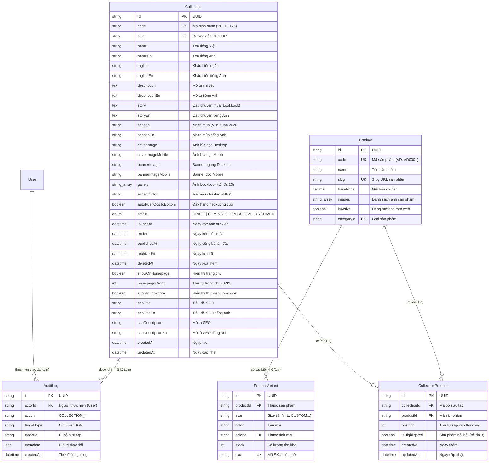
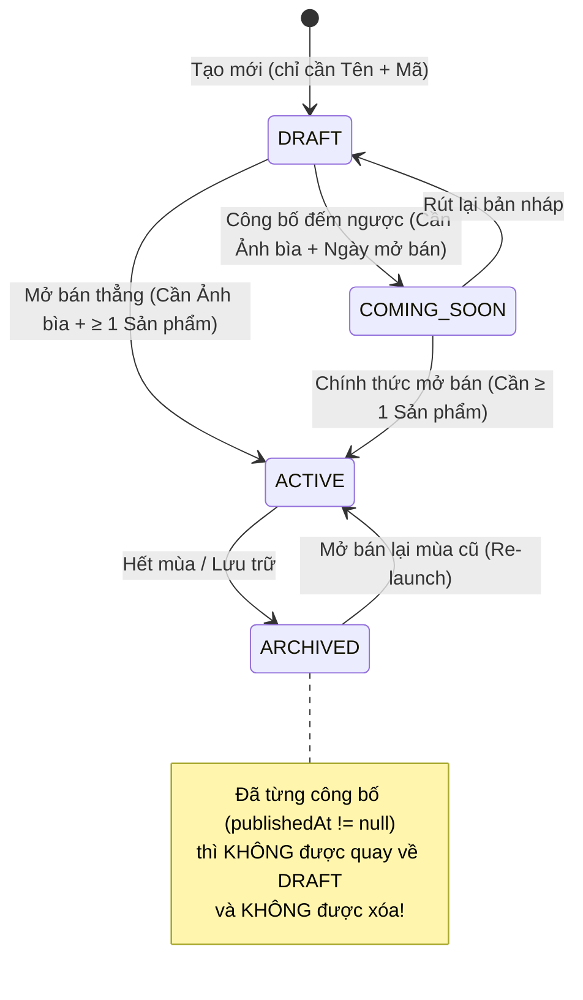

# 📖 Tài liệu Nghiệp vụ & Kiến trúc Cơ sở Dữ liệu — Phân hệ Bộ Sưu Tập Admin (Collections)

> **Dự án:** Thương mại điện tử Áo Dài cao cấp — **Thiên Canh**  
> **Khu vực:** Quản trị nội bộ (`apps/web` — Admin Portal)  
> **Đường dẫn module:** `apps/web/src/features/admin/modules/collections`  
> **Đường dẫn router:** `/admin/catalog/collections` và `/admin/catalog/collections/[id]`  
> **Quyền hạn truy cập (`Permission`):** `MANAGE_INVENTORY` (hoặc vai trò `ADMIN` / Super Admin)  
> **Ngày cập nhật:** 17/11/2026  

---

## 1. Tổng quan Nghiệp vụ Phân hệ Bộ Sưu Tập

Tiệm Thiên Canh kinh doanh Áo Dài may sẵn và may đo thủ công gắn liền với văn hóa các mùa trong năm (Tết, Xuân, Hạ, Thu, Đông, Lễ hội, Cưới hỏi...). **Bộ sưu tập (Collection)** là trái tim của chiến lược sản phẩm và định vị thương hiệu:
- Kể câu chuyện văn hóa, chất liệu, màu sắc chủ đạo của từng mùa thời trang.
- Gom nhóm sản phẩm Áo Dài, Quần, Phụ kiện theo concept thiết kế.
- Cung cấp trải nghiệm **Lookbook** ảnh nghệ thuật và **Banner** trang chủ.
- Hỗ trợ công cụ quảng cáo (chiến dịch sắp ra mắt có đồng hồ đếm ngược, mở bán, lưu trữ mùa cũ).

---

## 2. Mô hình Cơ sở Dữ liệu & Mối quan hệ (Prisma Database Models)

Hệ thống quản lý Bộ sưu tập tương tác trực tiếp với **5 bảng dữ liệu chính** trong PostgreSQL thông qua Prisma ORM:

### Chi tiết các Bảng & Ràng buộc toàn vẹn

### 2.1. Bảng `Collection`
- **Khóa chính**: `id` (`UUID`).
- **Ràng buộc duy nhất (`@unique`)**:
  - `code`: Mã bộ sưu tập (viết hoa không dấu, độ dài 2–12 ký tự, regex: `^[A-Z0-9]{2,12}$`). Mã này là **gốc sinh mã SKU** cho biến thể sản phẩm.
  - `slug`: Đường dẫn URL đại diện cho bộ sưu tập trên website (vd: `tet-2026`). Tự động chống trùng lặp bằng cách thêm hậu tố `-2`, `-3`...
- **Xóa mềm (`deletedAt`)**: Mọi truy vấn mặc định lọc `deletedAt = null`.
- **Lưu trữ ảnh**: URL chuỗi trỏ về Cloudinary/CDN, hỗ trợ tách riêng ảnh hiển thị màn hình máy tính và điện thoại.

### 2.2. Bảng `CollectionProduct` (Liên kết nhiều - nhiều n:n)
- Thiết lập quan hệ nhiều - nhiều giữa `Collection` và `Product`.
- **Ràng buộc toàn vẹn**:
  - `fields: [collectionId], references: [id], onDelete: Cascade`: Xóa bộ sưu tập thì tự động xóa dòng liên kết.
  - `fields: [productId], references: [id], onDelete: Cascade`: Xóa sản phẩm thì tự động gỡ sản phẩm khỏi bộ sưu tập.
  - `@@unique([collectionId, productId])`: Chống thêm trùng 1 sản phẩm nhiều lần vào cùng một bộ sưu tập.
  - `@@index([productId])`: Tối ưu hóa truy vấn ngược khi cần tìm *"Sản phẩm này đang thuộc những bộ sưu tập nào"*.
- **Trường nghiệp vụ**:
  - `position`: Thứ tự hiển thị số nguyên tăng dần (`0, 1, 2...`).
  - `isHighlighted`: Cờ đánh dấu sản phẩm đại diện nổi bật của mùa (hiển thị to ở vị trí đầu trang).

### 2.3. Bảng `Product` và `ProductVariant`
- Một sản phẩm có thể tham gia vào **nhiều bộ sưu tập khác nhau** cùng một lúc (VD: Vừa thuộc BST mùa mới, vừa thuộc BST bán chạy hoặc Di sản).
- Tồn kho của sản phẩm được tính tổng từ bảng `ProductVariant`:
  $$\text{totalStock} = \sum \text{variant.stock}$$
- Khi $\text{totalStock} \le 0$, sản phẩm được coi là hết hàng (Out of Stock - OOS).

### 2.4. Bảng `AuditLog`
Ghi vết lịch sử mọi hành động nhạy cảm với `targetType = "COLLECTION"`:
- `COLLECTION_CREATED`: Ghi nhận `name`, `code`.
- `COLLECTION_UPDATED`: Ghi nhận số lượng sản phẩm trước/sau, thay đổi trạng thái trang chủ.
- `COLLECTION_STATUS_CHANGED`: Ghi nhận trạng thái chuyển đổi, danh sách ID sản phẩm được kích hoạt bán, danh sách ID sản phẩm bị ẩn.
- `COLLECTION_HOMEPAGE_UPDATED`: Bật/tắt cờ trang chủ.
- `COLLECTION_DELETED`: Ghi nhận thao tác xóa mềm bản nháp.

---

## 3. Quy chuẩn Nghiệp vụ Chi tiết (Business Logic Rules)

### 3.1. Máy trạng thái Vòng đời (Collection Lifecycle State Machine)

Bộ sưu tập vận hành qua 4 trạng thái cố định:

#### Ma trận chuyển dịch trạng thái (`COLLECTION_TRANSITIONS`)
| Trạng thái hiện tại | Được phép chuyển sang | Mục đích nghiệp vụ |
| :--- | :--- | :--- |
| **`DRAFT` (Nháp)** | `COMING_SOON`, `ACTIVE` | Đang biên tập nội dung, chọn sản phẩm, chuẩn bị hình ảnh |
| **`COMING_SOON` (Sắp ra mắt)** | `DRAFT`, `ACTIVE` | Công bố trước truyền thông, chạy quảng cáo, đếm ngược ngày mở bán |
| **`ACTIVE` (Đang mở bán)** | `ARCHIVED` | Đang bán trên storefront, hiển thị sản phẩm, gắn tag mùa |
| **`ARCHIVED` (Lưu trữ / Hết mùa)** | `ACTIVE` | Mùa kết thúc; giữ lại trong thư viện Lookbook lịch sử; có thể mở bán lại |

> [!IMPORTANT]
> **Nguyên tắc không quay về DRAFT từ ARCHIVED:**  
> Bộ sưu tập đã lưu trữ (`ARCHIVED`) chỉ có thể mở bán lại (`ACTIVE`), tuyệt đối không được quay về `DRAFT` vì đường dẫn URL và mã nhận diện đã được truyền thông, lập chỉ mục Google và liên kết với lịch sử mua hàng của khách.

---

### 3.2. Điều kiện Chặn Chuyển trạng thái (Transition Blockers)

Khi người dùng thao tác chuyển trạng thái, hệ thống kiểm tra các rào cản nghiệp vụ:
1. **Lên `COMING_SOON` hoặc `ACTIVE`**: Bắt buộc phải có **Ảnh bìa** (`coverImage`) (`COLLECTION_COVER_REQUIRED`).
2. **Lên `COMING_SOON`**: Bắt buộc phải có **Ngày mở bán dự kiến** (`launchAt`) (`COLLECTION_LAUNCH_DATE_REQUIRED`) để storefront hiển thị bộ đếm ngược.
3. **Lên `ACTIVE`**: Bắt buộc phải có **ít nhất 1 sản phẩm** bên trong (`productCount > 0`) (`COLLECTION_PRODUCTS_REQUIRED`).

---

### 3.3. Tác động Dây chuyền lên Sản phẩm (Cascade Product Impact)

Mỗi lần chuyển đổi trạng thái của Bộ sưu tập sẽ kích hoạt hộp thoại xác nhận đo lường tác động lên các sản phẩm bên trong:

#### Trường hợp 1: Chuyển sang `ACTIVE` (Mở bán)
- **Tùy chọn `activateReadyProducts`** (Mặc định bật): Tự động bật bán (`Product.isActive = true`) cho những sản phẩm đang ẩn nhưng **đã đủ điều kiện** (`isReady = true`).
- **Tiêu chí một sản phẩm được coi là đủ điều kiện (`isReady`)**:
  - Đã có ít nhất 1 ảnh đại diện (`images.length > 0`).
  - Giá bán cơ bản hợp lệ (`basePrice > 0`).
  - Đã có ít nhất 1 biến thể SKU khả dụng.
- **Sản phẩm chưa đủ điều kiện (`skipped`)**: Hệ thống tự động bỏ qua, không bật bán và hiển thị thông báo số lượng sản phẩm bị bỏ qua để nhân sự kiểm tra lại giá/ảnh.

#### Trường hợp 2: Chuyển sang `COMING_SOON` hoặc `ARCHIVED` (Lưu trữ / Hết mùa)
- **Tùy chọn `hideExclusiveProducts`** (Mặc định bật): Tự động ẩn (`Product.isActive = false`) những sản phẩm **bán độc quyền** trong bộ sưu tập này.
- **Quy tắc bảo vệ sản phẩm dùng chung (Shared Active Protection):**
  - Nếu sản phẩm $A$ thuộc Bộ sưu tập Tết (chuẩn bị lưu trữ), nhưng đồng thời $A$ cũng đang nằm trong "Bộ Sưu Tập Áo Dài Di Sản" (đang `ACTIVE`), thì $A$ **sẽ KHÔNG bị ẩn**.
  - Sản phẩm chỉ bị ẩn khi nó **không còn thuộc bất kỳ bộ sưu tập nào khác đang `ACTIVE`**.

---

### 3.4. Khóa Danh tính Bộ sưu tập (Identity Lock)

- Khi bộ sưu tập được công bố lần đầu ra công chúng (`publishedAt !== null`):
  - **Mã bộ sưu tập (`code`) bị khóa cứng**, không cho phép chỉnh sửa.
  - **Đường dẫn URL (`slug`) bị khóa cứng**, không cho phép chỉnh sửa.
- **Lý do kỹ thuật & nghiệp vụ:**
  - `code` đã được sử dụng làm tiền tố cấu thành mã SKU cho các biến thể trong kho hàng (VD: `TET26-AD01-DO-S`). Đổi mã sẽ làm sai lệch tồn kho vật lý và mã vạch in trên tem áo.
  - `slug` đã được đưa vào chiến dịch Marketing, quảng cáo Facebook/Google, sitemap và index SEO. Đổi slug sẽ làm gãy link khách truy cập (404).

---

### 3.5. Xóa mềm An toàn (Safe Soft-Delete)

- **Cấm xóa bộ sưu tập đã từng công bố:**  
  Nếu bộ sưu tập có `publishedAt !== null`, Server Action `deleteCollectionAction` lập tức từ chối với mã lỗi `COLLECTION_DELETE_PUBLISHED`. Nhân sự chỉ có thể chọn chuyển trạng thái sang `ARCHIVED`.
- **Cơ chế xóa mềm bản nháp (`DRAFT`):**
  - Cập nhật `deletedAt = now()`.
  - Tắt cờ trang chủ `showOnHomepage = false`.
  - **Giải phóng ràng buộc Unique:** Đổi mã `code` và `slug` kèm hậu tố timestamp base36:
    $$\text{code} \leftarrow \text{code}\sim\text{DEL}-\langle\text{timestamp}\rangle$$
    $$\text{slug} \leftarrow \text{slug}-\text{deleted}-\langle\text{timestamp}\rangle$$
    *Nhờ cơ chế này, nếu sau đó nhân sự muốn tạo lại một bộ sưu tập mới với cùng mã `TET26` hay slug `tet-2026`, cơ sở dữ liệu sẽ không bị lỗi đụng độ Unique Key.*

---

### 3.6. Giới hạn & Thứ tự Hiển thị Trang chủ (Homepage Limit)

- **Giới hạn tối đa:** Trang chủ chỉ hiển thị tối đa **4 bộ sưu tập** cùng lúc (`HOMEPAGE_COLLECTION_LIMIT = 4`) để đảm bảo tốc độ tải trang và không làm loãng sự chú ý của khách hàng.
- **Tự động gỡ khỏi trang chủ:** Khi một bộ sưu tập chuyển sang trạng thái `ARCHIVED`, hệ thống tự động gỡ cờ `showOnHomepage = false`.
- **Kiểm tra khi bật:** Nếu một bộ sưu tập đang tắt cờ trang chủ mà Admin muốn bật lên, Server Action sẽ đếm số lượng bộ sưu tập chưa lưu trữ đang chiếm chỗ. Nếu đã đủ 4 thì chặn thao tác và trả về `COLLECTION_HOMEPAGE_LIMIT`.
- **Thứ tự sắp xếp (`homepageOrder`):** Điểm số từ `0` đến `99`, số càng nhỏ càng ưu tiên hiển thị trước.

---

### 3.7. Tự động Đẩy Hàng Hết xuống cuối (`autoPushOosToBottom`)

- Trong một mùa thời trang, một số mẫu áo dài có thể hết sạch vải hoặc hết các size phổ thông (`totalStock <= 0`).
- Khi cờ `autoPushOosToBottom = true` (mặc định bật):
  - Hệ thống tự động sắp xếp các sản phẩm còn hàng (`totalStock > 0`) lên trước, các sản phẩm hết hàng xuống cuối trang.
  - Giữ nguyên thứ tự tương đối giữa các sản phẩm còn hàng với nhau và giữa các sản phẩm hết hàng với nhau.
  - Sản phẩm hết hàng **không được phép chiếm vị trí nổi bật** (`isHighlighted`), đảm bảo khách hàng khi bấm vào bộ sưu tập luôn nhìn thấy sản phẩm có thể đặt mua ngay.

---

### 3.8. Sản phẩm Nổi bật của Mùa (`MAX_HIGHLIGHTED_PRODUCTS`)

- Mỗi bộ sưu tập được phép chọn tối đa **3 sản phẩm nổi bật** (`isHighlighted = true`).
- Các sản phẩm này sẽ được hiển thị với kích thước lớn ở phần đầu trang bộ sưu tập trên Storefront.
- Hệ thống chặn lưu form ở cả Client Zod Schema lẫn Server Action nếu số lượng nổi bật vượt quá 3 (`COLLECTION_HIGHLIGHT_LIMIT`).
- Tổng số lượng sản phẩm tối đa trong 1 bộ sưu tập là **200 sản phẩm** (`MAX_COLLECTION_PRODUCTS = 200`).

---

### 3.9. Quản lý Hình ảnh & Lookbook

- **Ảnh bìa (Cover Image):**
  - Tỉ lệ dọc tiêu chuẩn 3:4.
  - Hỗ trợ `coverImage` (bản máy tính) và `coverImageMobile` (bản cắt gọn cho điện thoại).
- **Banner đầu trang (Banner Image):**
  - Hỗ trợ `bannerImage` (banner ngang màn rộng) và `bannerImageMobile` (banner dọc tỉ lệ 4:5 hoặc 9:16 cho điện thoại để tránh bị mất chủ thể người mẫu).
- **Thư viện Lookbook (`gallery`):**
  - Chứa tối đa **20 ảnh nghệ thuật** (`MAX_GALLERY_IMAGES = 20`).
- **Nén ảnh tự động tại Client (`compressCollectionImage`):**
  - Giới hạn dung lượng tải lên tối đa: 5MB (`MAX_IMAGE_BYTES`).
  - Tự động nén sang định dạng ảnh hiện đại `WebP` với mức chất lượng 85% (`WEBP_QUALITY = 0.85`), cạnh dài tối đa 2400px.

---

### 3.10. Nội dung Đa ngôn ngữ (Bilingual VI / EN)

Tuân thủ quy chuẩn quốc tế hóa (`AGENTS.md §9`):
- Mọi trường văn bản đều có bản dịch Tiếng Anh đối ứng:
  - Tên: `name` / `nameEn` (max 120 ký tự).
  - Tagline: `tagline` / `taglineEn` (max 160 ký tự).
  - Nhãn mùa: `season` / `seasonEn` (max 60 ký tự).
  - Mô tả: `description` / `descriptionEn` (max 3000 ký tự).
  - Câu chuyện mùa: `story` / `storyEn` (max 8000 ký tự).
  - SEO: `seoTitle` / `seoTitleEn`, `seoDescription` / `seoDescriptionEn`.
- Trên giao diện trình soạn thảo có nút chuyển đổi ngôn ngữ segmented (`AdminLangSwitch`) giúp nhân viên chuyển tab VI / EN mượt mà.

---

## 4. Danh mục File & Kiến trúc Mã nguồn

| Thư mục / File | Vai trò kiến trúc |
| :--- | :--- |
| `schemas/collections.schemas.ts` | Khai báo Zod Schema xác thực dữ liệu: giới hạn độ dài chữ, regex mã code, regex URL ảnh, kiểm tra logic `endAt >= launchAt`, giới hạn nổi bật ≤ 3. |
| `actions/collections.actions.ts` | Các Server Action `"use server"`: `createCollectionAction`, `saveCollectionAction`, `changeCollectionStatusAction`, `setCollectionHomepageAction`, `deleteCollectionAction`. Thực hiện phân quyền, kiểm tra xung đột, giao dịch Prisma `$transaction`, ghi Audit Log và Revalidate cache. |
| `queries/collections.queries.ts` | Các hàm đọc cơ sở dữ liệu chuyên biệt: `getAdminCollectionsQuery`, `getAdminCollectionDetailQuery`, `getCollectionPickerProductsQuery`, `getCollectionProductStatesQuery`, `getCollectionStatusImpactQuery`. |
| `types/collections.types.ts` | Định nghĩa TypeScript Interface cho DTO danh sách, chi tiết, bộ chọn sản phẩm và cấu trúc báo cáo tác động trạng thái. |
| `utils/collectionLifecycle.ts` | Hằng số nghiệp vụ (`HOMEPAGE_COLLECTION_LIMIT = 4`, `MAX_HIGHLIGHTED_PRODUCTS = 3`), ma trận chuyển đổi trạng thái, hàm kiểm tra điều kiện chặn (`getTransitionBlockers`), hàm sắp xếp tồn kho (`orderCollectionProducts`). |
| `utils/collectionImage.ts` | Xử lý nén ảnh client-side bằng `HTMLCanvasElement` sang WebP 85%. |
| `utils/collectionStatusMeta.ts` | Định nghĩa icon Lucide, bảng màu trạng thái, màu nhấn mặc định (`DEFAULT_ACCENT = #71717A`) và các màu gợi ý (`ACCENT_PRESETS`). |
| `components/list/CollectionsBoard.tsx` | Màn hình danh sách: Lưới thẻ bộ sưu tập, thanh tìm kiếm từ khóa, bộ lọc trạng thái vòng đời, bộ lọc hiển thị trang chủ. |
| `components/editor/CollectionEditor.tsx` | Màn hình soạn thảo chi tiết: Bố cục 2 cột (Cột trái: Thông tin chung, Media, Sản phẩm; Cột phải: Vòng đời, Hiển thị trang chủ, SEO, Tiến độ hoàn thiện). |
| `components/dialog/ProductPickerDialog.tsx` | Hộp thoại chọn sản phẩm: Tìm kiếm, lọc danh mục, hiển thị giá VND, số lượng tồn kho và các bộ sưu tập khác sản phẩm đang thuộc. |
| `components/shared/ChangeCollectionStatusDialog.tsx` | Hộp thoại xác nhận chuyển đổi vòng đời kèm báo cáo tác động sản phẩm trước khi thực hiện. |
| `components/shared/ConfirmDeleteCollectionDialog.tsx` | Hộp thoại xác nhận xóa mềm bản nháp chưa công bố. |

---

## 5. Danh sách Mã Phản hồi & Lỗi Nghiệp vụ (Response Keys)

Tất cả các thông báo lỗi và trạng thái từ Server Action đều trả về dưới dạng **MÃ KEY** viết hoa (`UPPER_SNAKE_CASE`) và được dịch tự động ở `apps/web/messages/*/admin.json`:

| Mã lỗi / Phản hồi | Ngữ cảnh xuất hiện | Ý nghĩa |
| :--- | :--- | :--- |
| `COLLECTION_CODE_DUPLICATE` | Tạo / Cập nhật | Mã bộ sưu tập đã tồn tại trong hệ thống |
| `COLLECTION_CODE_LOCKED` | Cập nhật | Bộ sưu tập đã công bố thì không được đổi mã hoặc slug |
| `COLLECTION_CODE_INVALID` | Validate form | Mã không đúng định dạng (phải từ 2–12 chữ in hoa/số) |
| `COLLECTION_COVER_REQUIRED` | Chuyển trạng thái | Thiếu ảnh bìa khi chuyển sang Sắp ra mắt hoặc Mở bán |
| `COLLECTION_LAUNCH_DATE_REQUIRED`| Chuyển trạng thái | Thiếu ngày mở bán dự kiến khi chuyển sang Sắp ra mắt |
| `COLLECTION_PRODUCTS_REQUIRED` | Chuyển trạng thái | Bộ sưu tập mở bán bắt buộc phải có ít nhất 1 sản phẩm |
| `COLLECTION_TRANSITION_INVALID` | Chuyển trạng thái | Bước chuyển đổi trạng thái không hợp lệ trong vòng đời |
| `COLLECTION_HOMEPAGE_LIMIT` | Bật cờ trang chủ | Trang chủ đã đạt giới hạn tối đa 4 bộ sưu tập |
| `COLLECTION_HIGHLIGHT_LIMIT` | Soạn thảo SP | Vượt quá giới hạn tối đa 3 sản phẩm nổi bật |
| `COLLECTION_DELETE_PUBLISHED` | Xóa bộ sưu tập | Không thể xóa bộ sưu tập đã từng công bố (chỉ được lưu trữ) |
| `COLLECTION_DATE_RANGE_INVALID` | Validate form | Ngày kết thúc mùa phải sau ngày mở bán |
| `COLLECTION_NOT_FOUND` | Mọi thao tác | Không tìm thấy bộ sưu tập hoặc đã bị xóa mềm |
