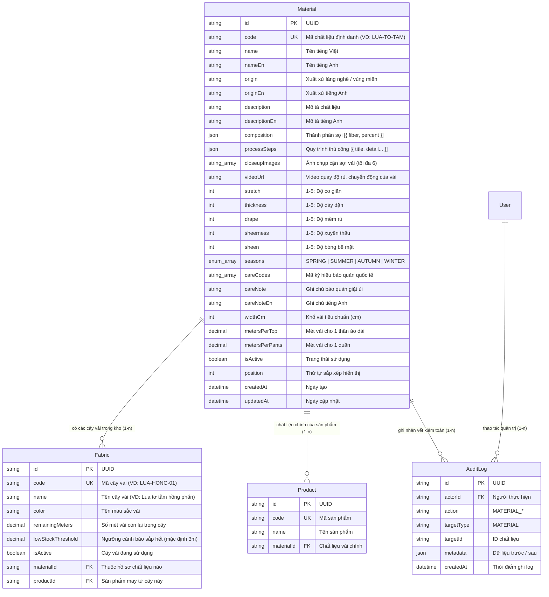

# 📖 Tài liệu Nghiệp vụ & Kiến trúc Cơ sở Dữ liệu — Phân hệ Chất Liệu Vải (Materials)

> **Dự án:** Thương mại điện tử Áo Dài cao cấp — **Thiên Canh**  
> **Khu vực:** Quản trị nội bộ (`apps/web` — Admin Portal)  
> **Đường dẫn module:** `apps/web/src/features/admin/modules/materials`  
> **Đường dẫn router:** `/admin/catalog/materials` và `/admin/catalog/materials/[id]`  
> **Quyền hạn truy cập (`Permission`):** `MANAGE_INVENTORY` (hoặc vai trò `ADMIN` / Super Admin)  
> **Ngày cập nhật:** 17/11/2026  

---

## 1. Tổng quan Nghiệp vụ Phân hệ Chất Liệu Vải

Trong nghệ thuật may đo Áo Dài truyền thống của tiệm **Thiên Canh**, **Chất liệu vải (Material)** là linh hồn quyết định phom dáng tà áo, độ bay rủ, độ bền và cảm xúc khi mặc (Lụa tơ tằm Bảo Lộc, Đũi tơ Nam Cao, Gấm Thượng Hải, Taffeta tơ, Voan cát, Nhung tuyết...).

Phân hệ Chất liệu vải trong Admin đảm nhiệm các vai trò cốt lõi:
1. **Hồ sơ Kỹ thuật & Di sản Văn hóa**: Định nghĩa nguồn gốc xuất xứ làng nghề, câu chuyện dệt nhuộm thủ công, thành phần sợi dệt tự nhiên (đủ 100%), quy trình sản xuất và ký hiệu giặt ủi bảo quản.
2. **Chuẩn hóa 5 Thanh đo Vật lý (1–5)**: Đo lường độ co giãn, độ dày, độ mềm rủ, độ xuyên thấu, độ bóng bề mặt để làm căn cứ tư vấn phom dáng chuẩn xác cho từng khách hàng và từng mùa trong năm.
3. **Định mức Cắt may Tiêu chuẩn**: Khai báo khổ vải (`widthCm`), định mức mét vải may một thân áo dài (`metersPerTop`), định mức mét may quần (`metersPerPants`).
4. **Phân biệt rạch ròi giữa Chất liệu (`Material`) và Cây vải thực tế (`Fabric`)**: Chất liệu là loại vải định danh chung; Cây vải là từng cuộn vải vật lý cụ thể trong kho có màu sắc và số mét tồn thực tế.

---

## 2. Mô hình Cơ sở Dữ liệu & Mối quan hệ (Prisma Database Models)



### Chi tiết các Bảng & Ràng buộc toàn vẹn

### 2.1. Bảng `Material` (Hồ sơ Chất liệu)
- **Khóa chính**: `id` (`UUID`).
- **Ràng buộc duy nhất (`@unique`)**:
  - `code`: Mã định danh ngắn gọn (viết hoa không dấu, ngăn cách bằng gạch nối, regex: `^[A-Z0-9]+(-[A-Z0-9]+)*$`, tối đa 40 ký tự, vd: `LUA-TO-TAM`, `GAM-THUONG-HAI`, `DUI-TO-NAM-CAO`).
- **Thành phần sợi (`composition` JSON)**:
  - Cấu trúc: `[{ "fiber": "SILK", "percent": 100 }]`.
  - Hỗ trợ các loại sợi cao cấp: `SILK`, `COTTON`, `LINEN`, `HEMP`, `BAMBOO`, `VISCOSE`, `POLYESTER`, `SPANDEX`, `NYLON`, `WOOL`, `OTHER`.
- **Quy trình thủ công (`processSteps` JSON)**:
  - Cấu trúc: `[{ "title": "...", "titleEn": "...", "detail": "...", "detailEn": "..." }]`.
  - Lưu lại các công đoạn dệt, nhuộm củ nâu, luộc tơ, hoàn tất vải thủ công (tối đa 8 bước).
- **Thanh đo vật lý chuẩn hóa 1–5**:
  - `stretch`, `thickness`, `drape`, `sheerness`, `sheen`. Giá trị từ 1 đến 5 (hoặc `null` nếu chưa đánh giá).
- **Mùa thời trang (`seasons` Enum Array)**:
  - Hỗ trợ: `SPRING`, `SUMMER`, `AUTUMN`, `WINTER`.
- **Ký hiệu bảo quản (`careCodes` String Array)**:
  - Mảng các mã ký hiệu giặt ủi tiêu chuẩn quốc tế (xem mục 3.5).
- **Định mức vải (`widthCm`, `metersPerTop`, `metersPerPants`)**:
  - `metersPerTop` (`Decimal(5, 2)`): Số mét vải tiêu chuẩn để cắt may 1 thân áo dài.
  - `metersPerPants` (`Decimal(5, 2)`): Số mét vải may 1 chiếc quần áo dài.
- **Chỉ mục (`@@index([isActive, position])`)**:
  - Tối ưu hóa truy vấn danh sách chất liệu đang hoạt động và sắp xếp thứ tự.

### 2.2. Bảng `Fabric` (Cây vải vật lý trong kho hàng)
- Đại diện cho từng cây vải thực tế lưu trữ tại kho của tiệm Thiên Canh:
  - `code`: Mã cây vải riêng biệt (vd: `LUA-HONG-01`, `LUA-XANH-02`).
  - `remainingMeters`: Số mét vải còn lại trong cuộn (đơn vị: mét, `Decimal(8, 2)`).
  - `lowStockThreshold`: Ngưỡng mét vải cảnh báo sắp hết (mặc định: `3.0` mét — xấp xỉ đủ may đúng 1 bộ áo dài).
  - `materialId`: Khóa ngoại trỏ về `Material.id` (`onDelete: SetNull`).

### 2.3. Bảng `Product` (Sản phẩm Áo Dài)
- Mỗi sản phẩm có thể gắn một chất liệu vải chính (`materialId`).
- Các thông số độ rủ, co giãn, hướng dẫn giặt ủi và thành phần vải sẽ tự động được kế thừa hiển thị trên trang chi tiết sản phẩm Storefront.

---

## 3. Quy chuẩn Nghiệp vụ Chi tiết (Business Logic Rules)

### 3.1. Phân biệt Bản chất: `Material` vs `Fabric`

Hệ thống phân tách rạch ròi hai khái niệm:

| Tiêu chí | Chất liệu (`Material`) | Cây vải (`Fabric`) |
| :--- | :--- | :--- |
| **Bản chất** | **Khái niệm / Loại vải** | **Vật thể vật lý cụ thể trong kho** |
| **Ví dụ** | Lụa tơ tằm Bảo Lộc (`LUA-TO-TAM`) | Cuộn lụa tơ tằm hồng phấn số 1 (`LUA-HONG-01`) |
| **Màu sắc** | Không gán cứng màu (chỉ quản lý tính chất mặt vải) | Gắn với 1 màu cụ thể (`color = "Hồng phấn"`) |
| **Số lượng** | Không lưu số lượng trực tiếp (chỉ lưu định mức m/áo) | Lưu số mét thực tế còn lại (`remainingMeters = 24.5 m`) |
| **Quy mô** | Một tiệm có khoảng 10 – 30 chất liệu tiêu chuẩn | Một tiệm có thể có hàng trăm cây vải khác màu |

---

### 3.2. Công thức Tính Số Áo Còn May Được theo TỪNG Cây Vải (`topsFromRolls`)

Trong cắt may Áo Dài cao cấp, **mỗi cây vải thuộc một lô dệt (dye lot) và màu sắc riêng biệt**. Không thể lấy vải vụn thừa của cây này chắp vá với cây khác để may một thân áo dài nguyên vẹn.

Do đó, hệ thống áp dụng nguyên tắc tính toán:
> **Không cộng gộp tổng mét vải rồi mới chia.** Số áo may được phải tính độc lập trên **TỪNG CÂY VẢI**, sau đó mới lấy tổng phần nguyên:

$$\text{tops} = \sum_{i=1}^{n} \left\lfloor \frac{\text{roll}_i.\text{remainingMeters}}{\text{metersPerTop}} \right\rfloor$$

*Ví dụ minh họa:*
- Định mức may 1 thân áo dài: `metersPerTop = 2.2` mét.
- Cây vải A (Lụa đỏ): còn `4.0` mét $\rightarrow \lfloor 4.0 / 2.2 \rfloor = 1$ áo (thừa 1.8m).
- Cây vải B (Lụa vàng): còn `3.5` mét $\rightarrow \lfloor 3.5 / 2.2 \rfloor = 1$ áo (thừa 1.3m).
- **Kết quả đúng**: May được **2 thân áo** (1 đỏ, 1 vàng).
- *(Nếu cộng dồn sai: $(4.0 + 3.5) / 2.2 = 7.5 / 2.2 \approx 3$ áo $\rightarrow$ Sai thực tế vì 1.8m đỏ không thể ghép với 1.3m vàng để may thân áo thứ 3).*

---

### 3.3. Tình trạng Vải Công khai trên Storefront (`resolveMaterialAvailability`)

Để bảo mật tồn kho thực tế của xưởng và tạo cảm giác khan hiếm thủ công cao cấp, storefront **tuyệt đối không hiển thị số mét vải cụ thể**, mà quy đổi thành 3 trạng thái công khai:

$$\text{resolveMaterialAvailability}(\text{rollCount}, \text{tops})$$

| Trạng thái Storefront | Điều kiện kích hoạt | Trải nghiệm khách hàng |
| :--- | :--- | :--- |
| **`AVAILABLE` (Còn vải)** | Còn $\ge 1$ cây vải và may được **$> 3$ thân áo** | Khách an tâm đặt may đo hoặc chọn size tiêu chuẩn |
| **`LIMITED` (Số lượng có hạn)** | Còn $\ge 1$ cây vải nhưng chỉ may được **$\le 3$ thân áo** | Gợi ý khách nên đặt sớm trước khi hết cây vải của mùa |
| **`ON_REQUEST` (Đặt dệt theo yêu cầu)** | Hết sạch vải trong kho (`tops === 0` hoặc không có cây vải) | Nút bấm chuyển sang *"Liên hệ tiệm đặt dệt riêng"* |

---

### 3.4. Hệ thống 5 Thanh đo Vật lý Chuẩn hóa (1–5)

Năm thanh đo vật lý (`stretch`, `thickness`, `drape`, `sheerness`, `sheen`) là công cụ tư vấn chuyên môn sắc bén của Thiên Canh:

| Thanh đo | Thang điểm 1 | Thang điểm 3 (Trung bình) | Thang điểm 5 | Ứng dụng thực tế khi may Áo Dài |
| :--- | :--- | :--- | :--- | :--- |
| **Độ co giãn (`stretch`)** | Hoàn toàn không giãn (Lụa tơ, Gấm) | Co giãn nhẹ 2 chiều | Co giãn 4 chiều linh hoạt | Cần cộng cử động nhiều hay ít khi cắt may |
| **Độ dày (`thickness`)** | Mỏng nhẹ bay bổng (Voan, Tơ tằm) | Dày dặn vừa phải (Đũi, Linen) | Dày, giữ ấm tốt (Nhung tuyết, Gấm dày) | Chọn vải mặc mùa hè hay mùa đông |
| **Độ mềm rủ (`drape`)** | Đứng phom, có độ đơ (Taffeta, Organza) | Rủ tự nhiên | Mềm rủ thướt tha ôm sát đường cong | Áo dài truyền thống cần rủ mềm; Áo cách tân tay bồng cần đứng phom |
| **Độ xuyên thấu (`sheerness`)** | Kín đáo 100%, không lộ nội y | Nhìn mờ ảo dưới ánh sáng mạnh | Xuyên thấu rõ nét (Voan tơ mỏng) | Quyết định có bắt buộc phải may lót thân áo hay không |
| **Độ bóng (`sheen`)** | Mờ lỳ tự nhiên, thô mộc (Đũi, Linen) | Ánh sáng nhẹ óng ả (Lụa tơ tằm) | Bóng bắt sáng lộng lẫy (Satin, Gấm kim tuyến) | Chọn trang phục dạo phố giản dị hay áo dài dạ tiệc / lễ cưới |

---

### 3.5. Thành phần Sợi & Kiểm tra Tổng 100%

- Danh sách sợi tự nhiên & tổng hợp: `SILK` (Tơ tằm), `COTTON` (Bông), `LINEN` (Đũi/Lanh), `HEMP` (Gai dầu), `BAMBOO` (Sợi tre), `VISCOSE`, `POLYESTER`, `SPANDEX`, `NYLON`, `WOOL` (Len lông cừu), `OTHER`.
- Tối đa **6 loại sợi** trong 1 chất liệu (`MAX_COMPOSITION_ITEMS = 6`).
- **Quy tắc toán học nghiêm ngặt (`MATERIAL_COMPOSITION_INVALID`):**
  - Khi đã khai báo thành phần: **Tổng tỷ lệ phần trăm bắt buộc phải đúng 100%** ($\sum \text{percent} = 100$).
  - Không được chọn trùng một loại sợi nhiều lần trong danh sách.
  - Trên giao diện có thanh hiển thị trực quan tỷ lệ các sợi (`CompositionBar`).

---

### 3.6. Ký hiệu Bảo quản Quốc tế & Xem trước Nhãn May (`CareLabel`)

Hệ thống định nghĩa sẵn 10 mã ký hiệu giặt ủi quốc tế chuyên dụng cho Áo Dài thủ công:

| Mã ký hiệu (`CareCode`) | Icon hiển thị | Ý nghĩa hướng dẫn bảo quản |
| :--- | :--- | :--- |
| **`HAND_WASH`** | `Hand` | Giặt tay nhẹ nhàng, không chà xát mạnh |
| **`MACHINE_GENTLE`** | `WashingMachine` | Giặt máy ở chế độ giặt đồ lụa / đồ mỏng nhẹ |
| **`COLD_WATER`** | `Snowflake` | Giặt bằng nước lạnh ($< 30^\circ\text{C}$), không giặt nước nóng |
| **`NO_BLEACH`** | `Ban` | Tuyệt đối không dùng chất tẩy rửa clo / javel |
| **`NO_WRING`** | `Droplets` | Không vặn xoắn tà áo (ép ráo nước bằng khăn bông) |
| **`DRY_SHADE`** | `CloudSun` | Phơi trong bóng râm thoáng gió, tránh ánh nắng gắt |
| **`IRON_LOW`** | `Thermometer` | Ủi ở nhiệt độ thấp ($< 110^\circ\text{C}$), ủi mặt trái |
| **`STEAM`** | `CloudFog` | Ưu tiên là / ủi bằng bàn ủi hơi nước đứng |
| **`DRY_CLEAN`** | `Sparkles` | Giặt khô chuyên nghiệp (khuyên dùng cho Áo Dài gấm/thêu tay) |
| **`STORE_HANGING`** | `Shirt` | Treo bảo quản bằng móc gỗ có đệm mút, không gấp nếp |

- **Bộ mô phỏng nhãn may (`CareLabel`):** Giao diện Admin mô phỏng hình ảnh chiếc nhãn satin may sườn áo độc bản của Thiên Canh, kết hợp tự động giữa thành phần sợi 100%, các icon bảo quản đã chọn và dòng chữ *"Made in Vietnam"*, giúp nhân sự hình dung trực quan tem áo trước khi in xưởng.

---

### 3.7. Quy tắc Xóa Chất liệu An toàn (`deleteMaterialAction`)

- **Bảo vệ toàn vẹn dữ liệu kho:** Chất liệu vải là hồ sơ cha của các cây vải tồn kho.
- **Ràng buộc an toàn:**
  - Hệ thống chỉ cho phép xóa chất liệu khi **chưa từng có bất kỳ cây vải nào trong kho liên kết với nó** (`_count.fabrics === 0`).
  - Nếu chất liệu đã phát sinh dù chỉ 1 cây vải (kể cả cây vải đã dùng hết 0 mét), Server Action lập tức chặn lại và trả về lỗi `MATERIAL_IN_USE`.
  - Trong tình huống không còn sử dụng loại vải này, nhân sự phải dùng thao tác **Tắt hoạt động** (`isActive = false`) để ẩn khỏi bảng danh mục và các bộ lọc.

---

## 4. Trải nghiệm Giao diện Quản trị (UI Architecture)

### 4.1. Màn hình Danh sách `/admin/catalog/materials` (`MaterialsBoard`)
Hỗ trợ chuyển đổi linh hoạt giữa 2 góc nhìn:

```
┌────────────────────────────────────────────────────────────────────────┐
│ [AdminListPanel] Tiêu đề + Tìm kiếm + Lọc Mùa/Sợi + [Thẻ / Ma trận]   │
├───────────────────────────────────┬────────────────────────────────────┤
│ GÓC NHÌN 1: Ô VẢI MẪU (Cards)     │ GÓC NHÌN 2: MA TRẬN SO SÁNH (Matrix)│
│                                   │                                    │
│ - Ảnh chụp cận chất liệu (3:4)    │ - Bảng so sánh 5 thanh đo vật lý   │
│ - Tên, xuất xứ làng nghề          │ - Cột: Co giãn | Dày | Rủ | Thấu | │
│ - Thanh màu thành phần sợi dệt    │   Bóng (thang điểm chấm 1 - 5)     │
│ - Thống kê: Số cây vải trong kho  │ - Giúp chuyên gia đối chiếu chọn   │
│ - Số áo dài còn may được          │   vải nhanh theo yêu cầu phom dáng │
└───────────────────────────────────┴────────────────────────────────────┘
```

- **Bộ lọc đa chiều:**
  - Lọc theo mùa: Tất cả, Xuân, Hạ, Thu, Đông.
  - Lọc theo loại sợi chính: Tơ tằm (`SILK`), Đũi/Lanh (`LINEN`), Bông (`COTTON`)...
  - Lọc theo trạng thái: Đang hoạt động, Tạm ẩn.
- **Tạo nhanh (`CreateMaterialDialog`):** Nhập nhanh mã định danh và tên chất liệu, hệ thống tự động gán vị trí cuối bảng và điều hướng sang màn soạn thảo chi tiết.

### 4.2. Màn hình Chi tiết `/admin/catalog/materials/[id]` (`MaterialEditor`)
Bố cục 2 cột tiêu chuẩn theo quy chuẩn AGENTS.md §8:
- **Cột trái (Nội dung chi tiết - 6 thẻ):**
  1. *Thông tin chung*: Chuyển đổi ngôn ngữ VI / EN (`AdminLangSwitch`), mã chất liệu, tên, xuất xứ làng nghề, mô tả.
  2. *Thành phần sợi*: Bảng nhập các loại sợi dệt kèm % (kiểm tra chuẩn tổng 100%).
  3. *Đặc tính vật lý & Mùa*: Chấm điểm 5 thanh đo 1–5 và chọn các mùa thích hợp.
  4. *Bảo quản & Nhãn may*: Chọn 10 icon giặt ủi, ghi chú và xem trước nhãn may satin.
  5. *Quy trình thủ công*: Danh sách tối đa 8 bước dệt nhuộm song ngữ VI/EN.
  6. *Hình ảnh & Video*: Tải lên tối đa 6 ảnh chụp cận mặt sợi vải và link video độ rủ.
- **Cột phải (Tổng quan & Tồn kho thực tế):**
  - Công tắc bật/tắt hoạt động `isActive`.
  - Khung định mức tiêu chuẩn: Khổ vải (`widthCm`), mét/thân áo (`metersPerTop`), mét/quần (`metersPerPants`).
  - Danh sách cây vải trong kho (`FabricRolls`): Mã cây vải, màu sắc, số mét còn lại, cảnh báo sắp hết đỏ chấm khi $< 3\text{m}$.
  - Tổng số thân áo dài còn may được tính theo từng cây vải.
  - Nút Xóa chất liệu (chỉ bấm được khi không có cây vải nào).

---

## 5. Danh mục File & Kiến trúc Mã nguồn

| Thư mục / File | Vai trò kiến trúc |
| :--- | :--- |
| `schemas/materials.schemas.ts` | Khai báo Zod Schema xác thực dữ liệu: `materialCodeSchema` (regex mã code), `createMaterialSchema`, `materialFormSchema` (kiểm tra tổng 100% sợi, 5 thanh đo 1–5, định mức vải). |
| `actions/materials.actions.ts` | Server Action `"use server"`: `createMaterialAction`, `updateMaterialAction`, `deleteMaterialAction`. Xử lý phân quyền, kiểm tra trùng lặp mã, chuyển đổi số thực `Prisma.Decimal`, ghi vết `AuditLog`. |
| `queries/materials.queries.ts` | Truy vấn cơ sở dữ liệu chuyên biệt: `getAdminMaterialsQuery` (tính tổng mét và số áo còn may được), `getAdminMaterialDetailQuery` (kèm danh sách cây vải thực tế). |
| `types/materials.types.ts` | Định nghĩa TypeScript Interface: `AdminMaterialListItem`, `AdminMaterialDetail`, `MaterialFabricRoll`, `CompositionItem`, `ProcessStep`. |
| `utils/materialMeta.ts` | Hằng số nghiệp vụ: `MAX_CLOSEUP_IMAGES = 6`, `MAX_PROCESS_STEPS = 8`, `MAX_COMPOSITION_ITEMS = 6`, Icon Lucide cho mùa và ký hiệu bảo quản, màu đơn sắc cho thanh sợi `COMPOSITION_SHADES`. |
| `components/list/MaterialsBoard.tsx` | Khung điều khiển danh sách: Chuyển đổi giữa Chế độ Thẻ (`MaterialCard`) và Chế độ Ma trận (`MaterialMatrix`), thanh tìm kiếm và bộ lọc mùa/sợi. |
| `components/list/MaterialCard.tsx` | Thẻ hiển thị ô vải mẫu, ảnh cận vải, xuất xứ, thanh sợi và thống kê áo may được. |
| `components/list/MaterialMatrix.tsx` | Bảng ma trận so sánh 5 thanh đo vật lý theo hàng và cột. |
| `components/editor/MaterialEditor.tsx` | Màn hình chi tiết toàn diện của một chất liệu vải. |
| `components/shared/CareLabel.tsx` | Component mô phỏng nhãn may satin Áo Dài độc bản. |
| `components/shared/CompositionBar.tsx` | Thanh biểu đồ trực quan hóa tỷ lệ phần trăm các sợi dệt. |
| `components/shared/MetricBars.tsx` | Thanh đo trực quan 5 mức độ vật lý 1–5. |

---

## 6. Danh sách Mã Phản hồi & Lỗi Nghiệp vụ (Response Keys)

Tất cả các thông báo phản hồi đều trả về dưới dạng **MÃ KEY** viết hoa và được dịch tự động ở `apps/web/messages/*/admin.json` & `errors.json`:

| Mã lỗi / Phản hồi | Ngữ cảnh xuất hiện | Ý nghĩa nghiệp vụ |
| :--- | :--- | :--- |
| `MATERIAL_CODE_INVALID` | Validate form | Mã chất liệu không đúng định dạng (chỉ chữ in hoa, số và gạch nối) |
| `MATERIAL_CODE_TAKEN` | Tạo / Cập nhật | Mã chất liệu đã tồn tại trong cơ sở dữ liệu |
| `MATERIAL_NAME_REQUIRED` | Validate form | Tên chất liệu vải không được để trống |
| `MATERIAL_COMPOSITION_INVALID` | Lưu thành phần | Tổng tỷ lệ phần trăm các sợi dệt không bằng 100% hoặc bị trùng loại sợi |
| `MATERIAL_STEP_TITLE_REQUIRED` | Quy trình | Tiêu đề bước quy trình dệt thủ công không được để trống |
| `MATERIAL_VIDEO_URL_INVALID` | Media | Đường dẫn video chuyển động của vải không phải URL hợp lệ |
| `MATERIAL_IN_USE` | Xóa chất liệu | Không thể xóa chất liệu đã phát sinh cây vải trong kho (hãy chọn Ẩn) |
| `MATERIAL_NOT_FOUND` | Mọi thao tác | Không tìm thấy chất liệu vải trong hệ thống |
| `MATERIAL_CREATE_FAILED` | Server Action | Tạo chất liệu thất bại do lỗi hệ thống |
| `MATERIAL_UPDATE_FAILED` | Server Action | Cập nhật chất liệu thất bại do lỗi hệ thống |
| `MATERIAL_DELETE_FAILED` | Server Action | Xóa chất liệu thất bại do lỗi hệ thống |
