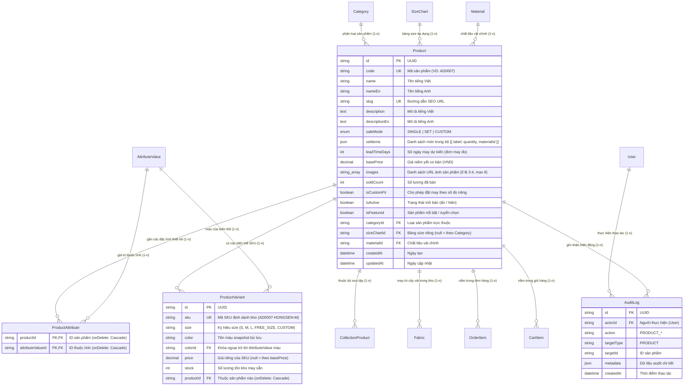

# 📖 Tài liệu Nghiệp vụ & Kiến trúc Cơ sở Dữ liệu — Phân hệ Sản Phẩm (Products)

> **Dự án:** Thương mại điện tử Áo Dài cao cấp — **Thiên Canh**  
> **Khu vực:** Quản trị nội bộ (`apps/web` — Admin Portal)  
> **Đường dẫn module:** `apps/web/src/features/admin/modules/products`  
> **Đường dẫn router:** `/admin/products` và `/admin/products/[id]`  
> **Quyền hạn truy cập (`Permission`):** `MANAGE_INVENTORY` (hoặc vai trò `ADMIN` / Super Admin)  
> **Ngày cập nhật:** 19/11/2026  

---

## 1. Tổng quan Nghiệp vụ Phân hệ Sản Phẩm

Trong toàn bộ hệ thống tiệm may Áo Dài **Thiên Canh**, **Sản phẩm (Product)** là thực thể trung tâm, nơi hội tụ và kế thừa toàn bộ các phân hệ danh mục nền tảng:
- **Kế thừa từ Loại sản phẩm (`Category`)**: Xác định nhóm hàng (`ProductGroup`), quyền nhận may đo theo số đo, đơn vị bán (cái/mét) và hình thức bán hợp lệ.
- **Kế thừa từ Bảng size mẫu (`SizeChart`)**: Cung cấp danh mục ký hiệu size chuẩn, các thông số đo đạc chi tiết và ngưỡng kích hoạt ngoại cỡ (Bigsize).
- **Kế thừa từ Chất liệu vải (`Material`)**: Tiếp nhận 5 thanh đo vật lý (co giãn, dày dặn, mềm rủ, xuyên thấu, bóng), biểu tượng giặt ủi bảo quản và định mức mét vải may cho một thân áo.
- **Kế thừa từ Thuộc tính (`Attributes`)**: Sử dụng nhóm màu sắc (`COLOR`) để sinh biến thể kho và chọn lọc các đặc tính thiết kế thủ công tinh xảo (`Design Traits`: kiểu cổ áo, kiểu tay, kỹ thuật hoa văn, chiều dài tà, dịp mặc).

### Quy trình Vận hành 2 Bước Tinh gọn:
1. **Bước 1 — Khởi tạo nhanh (`CreateProductDialog`)**: Quản trị viên chỉ cần nhập 3 thông tin cơ bản: Tên sản phẩm, Loại sản phẩm và Hình thức bán. Hệ thống tự động sinh Mã sản phẩm độc nhất theo tiền tố nhóm hàng (`AD0007`, `QD0002`...), sinh đường dẫn SEO (`slug`) và lưu trữ ở trạng thái ẩn (`isActive = false`).
2. **Bước 2 — Biên tập chuyên sâu (`ProductEditor` tại `/admin/products/[id]`)**: Nhân viên hoàn thiện nội dung chi tiết: mô tả song ngữ, tải ảnh chuẩn tỉ lệ 3:4, gắn chất liệu, chọn đặc tính thiết kế, thiết lập danh mục món trong bộ và sinh ma trận biến thể SKU kho hàng.

---

## 2. Mô hình Cơ sở Dữ liệu & Mối quan hệ (Prisma Database Models)



### Chi tiết các Bảng & Ràng buộc Toàn vẹn

### 2.1. Bảng `Product` (Hồ sơ Sản phẩm)
- **Khóa chính**: `id` (`UUID`).
- **Khóa duy nhất (`@unique`)**:
  - `code`: Mã định danh ngắn tự sinh theo tiền tố nhóm hàng (ví dụ: `AD0001`, `AD0002` cho Áo dài; `QD0001` cho Quần; `PK0001` cho Phụ kiện...). Mã này là **bất biến** làm gốc sinh toàn bộ SKU.
  - `slug`: Đường dẫn URL đại diện cho sản phẩm trên storefront (tự động loại bỏ dấu tiếng Việt, ví dụ: `ao-dai-gam-do-theu-hoa-cuc`). Khi trùng, hệ thống tự động đánh số hậu tố `-2`, `-3`.
- **Hình thức bán (`saleMode`)**:
  - Enum `SaleMode`: `SINGLE` (Bán lẻ 1 món), `SET` (Bán theo bộ), `CUSTOM` (Chuyên may đo).
- **Danh sách món trong bộ (`setItems` JSON)**:
  - Cấu trúc: `[{ label: string, labelEn?: string, quantity: number, materialId?: string | null }]`.
  - Chỉ áp dụng khi `saleMode === "SET"` (bắt buộc tối thiểu 2 món).
- **Quan hệ & Khóa ngoại**:
  - `categoryId`: Liên kết bắt buộc tới loại sản phẩm (`Category.id`, `onDelete: Restrict`).
  - `sizeChartId`: Khóa ngoại tùy chọn tới `SizeChart.id` (`onDelete: SetNull`). Nếu để trống, sản phẩm tự động kế thừa bảng size mặc định của loại sản phẩm.
  - `materialId`: Khóa ngoại tùy chọn tới `Material.id` (`onDelete: SetNull`).
- **Chỉ mục tối ưu hóa (`@@index`)**:
  - `@@index([categoryId])`, `@@index([sizeChartId])`, `@@index([materialId])`, `@@index([slug])`, `@@index([isActive, isFeatured])`.

### 2.2. Bảng `ProductVariant` (Biến thể SKU thực tế)
- **Khóa chính**: `id` (`UUID`).
- **Mã định danh kho (`sku` @unique)**:
  - Chuỗi định danh quản lý tồn kho duy nhất trên toàn hệ thống (ví dụ: `AD0007-HONGSEN-M`).
- **Phân loại biến thể**:
  - `size`: Chuỗi ký hiệu kích cỡ (ví dụ: `S`, `M`, `L`, `FREE_SIZE` cho phụ kiện, hoặc `CUSTOM` cho may đo).
  - `colorId`: Khóa ngoại trỏ tới `AttributeValue.id` của nhóm màu sắc `COLOR` (`onDelete: SetNull`).
  - `color`: Chuỗi snapshot tên màu tại thời điểm lưu (đảm bảo tem nhãn và đơn hàng cũ không bị mất chữ nếu thuộc tính màu bị sửa).
  - `price`: Kiểu `Decimal(12, 2)`. Nếu `null`, SKU sử dụng giá niêm yết cơ bản (`basePrice`) của sản phẩm.
  - `stock`: Tồn kho may sẵn. Với sản phẩm chuyên may đo (`saleMode === "CUSTOM"`), tồn kho luôn cố định bằng 0.

### 2.3. Bảng `ProductAttribute` (Bảng nối n-n Đặc tính Thiết kế)
- **Khóa chính tổng hợp (`@@id([productId, attributeValueId])`)**:
  - Lưu danh sách các đặc tính thiết kế thủ công gắn cho sản phẩm (kiểu cổ, kiểu tay, hoa văn, tà, dịp...).

---

## 3. Quy chuẩn & Thuật toán Nghiệp vụ Chi tiết

### 3.1. Hình thức Bán (`SaleMode`) & Ràng buộc Kế thừa Danh mục

Mỗi nhóm hàng trong danh mục có bản chất kinh doanh riêng biệt, quyết định trực tiếp các hình thức bán hợp lệ thông qua hàm `allowedSaleModes(group)`:

| Nhóm hàng (`ProductGroup`) | Hình thức bán cho phép | May đo riêng (`isCustomFit`) | Trục size (`resolveSizeAxis`) |
| :--- | :--- | :--- | :--- |
| **Áo dài (`AO_DAI`)** | `SINGLE` (Áo lẻ)<br>`SET` (Bộ áo + quần)<br>`CUSTOM` (May đo riêng) | Cho phép bật/tắt (Đo toàn thân `FULL`) | Theo bảng size (`chart`) hoặc thuộc tính size |
| **Quần (`PANTS`)** | `SINGLE` (Quần lẻ may sẵn)<br>`CUSTOM` (Quần may đo) | Cho phép bật/tắt (Đo thân dưới `PANTS`) | Theo bảng size (`chart`) |
| **Phụ kiện (`ACCESSORY`)** | `SINGLE` (Phụ kiện lẻ)<br>`SET` (Combo phụ kiện) | Không nhận may đo (`null`) | Không có size (`FREE_SIZE`) |
| **Giày guốc (`FOOTWEAR`)** | `SINGLE` (Một đôi guốc mộc) | Không nhận may đo (`null`) | Theo cỡ chân (`35, 36, 37...`) |
| **Nguyên liệu (`MATERIAL`)** | `SINGLE` (Vải bán theo mét) | Không nhận may đo (`null`) | Không có size (`FREE_SIZE`) |

#### Ràng buộc nghiệp vụ quan trọng:
1. **Bán theo bộ (`SET`)**: Bắt buộc phải khai báo ít nhất 2 món thành phần (`setItems.length >= 2`), ví dụ: *1 Áo dài + 1 Quần lụa*. Mỗi món có thể chọn chất liệu vải riêng biệt.
2. **Chuyên may đo (`CUSTOM`)**:
   - Chỉ cho phép đối với nhóm hàng có hỗ trợ may đo (`AO_DAI`, `PANTS`).
   - Tồn kho may sẵn của toàn bộ SKU luôn ép về `0` (`stock = 0`) vì tiệm chỉ may khi khách đặt đơn và cung cấp số đo.
   - Toàn bộ SKU mang ký hiệu size là `CUSTOM` (mã SKU tự động mang hậu tố `-MD`).
   - Bắt buộc khai báo số ngày may dự kiến (`leadTimeDays`, từ 1 đến 180 ngày).

---

### 3.2. Quy chuẩn Phát sinh Mã Sản Phẩm & Mã Biến Thể Kho (SKU)

Hệ thống xây dựng thuật toán sinh mã chuẩn mực, nhất quán và bất biến:

#### A. Mã Sản Phẩm Gốc (`code`)
Được tạo tự động theo tiền tố nhóm hàng (`PRODUCT_CODE_PREFIX`) và số thứ tự tăng dần gồm 4 chữ số:
- `AO_DAI` $\rightarrow$ `AD` (Ví dụ: `AD0001`, `AD0002`...)
- `PANTS` $\rightarrow$ `QD` (Ví dụ: `QD0001`, `QD0002`...)
- `ACCESSORY` $\rightarrow$ `PK` (Ví dụ: `PK0001`, `PK0002`...)
- `FOOTWEAR` $\rightarrow$ `GM` (Ví dụ: `GM0001`, `GM0002`...)
- `MATERIAL` $\rightarrow$ `VA` (Ví dụ: `VA0001`, `VA0002`...)

#### B. Quy tắc Sinh Mã SKU Tự động (`buildVariantSku`)
Cấu trúc chuẩn mực:
$$\text{SKU} = \langle\text{Mã sản phẩm}\rangle - \langle\text{Mã màu}\rangle - \langle\text{Ký hiệu size}\rangle$$
- **Chuẩn hóa chữ (`toSkuPart`)**: Tự động loại bỏ dấu tiếng Việt, ký tự đặc biệt, viết hoa toàn bộ và cắt tối đa 8 ký tự (ví dụ: *Đỏ nhung* $\rightarrow$ `DONHUNG`, *Hồng cánh sen* $\rightarrow$ `HONGCS`).
- **Xử lý size đặc biệt**:
  - Size may đo (`CUSTOM`) $\rightarrow$ Mã là `MD` (ví dụ: `AD0007-DONHUNG-MD`).
  - Size phụ kiện/vải (`FREE_SIZE`) $\rightarrow$ Bỏ qua phần size (ví dụ: `PK0003-DONHUNG`).
  - Sản phẩm không phân màu $\rightarrow$ Bỏ qua phần màu (ví dụ: `AD0007-M`).
- **Chống trùng lặp tuyệt đối**:
  - Khóa tổ hợp `comboKey(colorId, size)` ngăn ngừa người dùng tạo 2 dòng trùng cả màu lẫn size.
  - Phía server luôn tự tính toán lại mã SKU của các dòng tự sinh (`skuAuto = true`), nếu trùng với SKU cũ sẽ tự động nối thêm hậu tố `-2`, `-3`.
  - **SKU đã lưu giữ nguyên**: Khi cập nhật sản phẩm, các SKU đã lưu không bị tự động sinh lại mã để bảo toàn nhãn mã vạch đã in ấn trong kho.

---

### 3.3. Điều kiện Khắt khe để Kích hoạt Mở Bán (`isProductReadyToActivate`)

Nhằm bảo vệ trải nghiệm mua sắm của khách hàng trên Storefront và uy tín thương hiệu Thiên Canh, một sản phẩm chỉ được phép bật trạng thái **Đang bán (`isActive = true`)** khi thỏa mãn đồng thời **5 điều kiện nghiệp vụ**:

```text
                               ĐIỀU KIỆN MỞ BÁN SẢN PHẨM
  ┌─────────────────────────────────────────────────────────────────────────────┐
  │ 1. Hình ảnh: Có ảnh bìa chính và ít nhất 1 ảnh chi tiết (tối thiểu 2 ảnh)   │
  │ 2. Giá niêm yết: Giá cơ bản phải lớn hơn 0 (basePrice > 0)                  │
  │ 3. Biến thể kho: Phải có ít nhất 1 biến thể SKU (variants.length > 0)       │
  │ 4. Tổ hợp duy nhất: Không có bất kỳ SKU nào bị trùng tổ hợp Màu + Size      │
  │ 5. Đơn hàng theo bộ: Nếu là SET, bắt buộc khai báo từ 2 món thành phần trở lên│
  └─────────────────────────────────────────────────────────────────────────────┘
                                       │
                      ┌────────────────┴────────────────┐
                      ▼                                 ▼
             ĐỦ 5 ĐIỀU KIỆN                    THIẾU ĐIỀU KIỆN
         Cho phép bật mở bán               Chặn bật mở bán và trả mã
         (isActive = true)              PRODUCT_NOT_READY_TO_ACTIVATE
```

---

### 3.4. Chuẩn hóa Tỉ lệ & Tối ưu Hóa Hình Ảnh (`prepareProductImage`)

1. **Tỉ lệ khung hình dọc tiêu chuẩn 3:4 (`isProductImageRatio`)**:
   - Tôn vinh trọn vẹn dáng áo dài thướt tha từ cổ áo đến tà chấm gót.
   - Hệ thống tự động kiểm tra tỉ lệ chiều rộng / chiều cao của ảnh tải lên, từ chối các ảnh vuông hoặc ảnh ngang sai chuẩn (`IMAGE_RATIO_INVALID`).
2. **Nén định dạng WebP ngay tại trình duyệt client**:
   - Giới hạn dung lượng tối đa 5MB (`MAX_IMAGE_BYTES`).
   - Sử dụng Canvas API co tỉ lệ về chiều cao tối đa 2000px (`MAX_HEIGHT`) và nén chất lượng 85% (`WEBP_QUALITY = 0.85`).
   - Giảm tải dung lượng mạng lên tới 70% trước khi gửi lên API upload Cloudinary.
3. **Quy tắc ảnh bìa**:
   - Ảnh ở vị trí đầu tiên (`index = 0`) luôn là **Ảnh bìa đại diện (Cover Image)** hiển thị tại danh sách sản phẩm.
   - Hỗ trợ thao tác kéo thả hoặc bấm mũi tên để đổi vị trí ảnh bìa linh hoạt.

---

### 3.5. Ràng buộc Toàn vẹn Khi Xóa & Bảo Vệ Tồn Kho

1. **Bảo vệ SKU đã phát sinh giao dịch (`PRODUCT_VARIANT_IN_USE`)**:
   - Khi chỉnh sửa danh sách biến thể trong sản phẩm, hệ thống kiểm tra số lượng bản ghi liên quan trong `OrderItem` (đơn hàng) và `CartItem` (giỏ hàng).
   - Nếu SKU đã có đơn hàng hoặc đang trong giỏ của khách, Server Action sẽ **chặn xóa biến thể này** để bảo toàn lịch sử kế toán và đơn hàng.
2. **Cảnh báo tồn kho thấp (`LOW_STOCK_THRESHOLD = 3`)**:
   - Mọi SKU có số lượng tồn kho $\le 3$ cái được xếp vào diện nguy cơ hết hàng.
   - Danh sách sản phẩm tự động phân luồng vào tab "Sắp hết hàng" (`LOW_STOCK`) để thủ kho lên kế hoạch cắt may bổ sung kịp thời.

---

## 4. Kiến trúc Giao diện Người dùng (UI / UX Architecture)

### 4.1. Màn hình Danh sách Sản phẩm (`ProductsList`)

```text
┌────────────────────────────────────────────────────────────────────────────────────────┐
│ [Icon Shirt] Danh sách sản phẩm                                    [+ Thêm sản phẩm]   │
│ Quản lý danh mục áo dài, quần may sẵn, may đo và phụ kiện                              │
├────────────────────────────────────────────────────────────────────────────────────────┤
│ [Tất cả (128)]  [Đang bán (96)]  [Sắp hết hàng (8)]  [Hết hàng (4)]  [Đang ẩn (20)]   │
├────────────────────────────────────────────────────────────────────────────────────────┤
│ [🔍 Tìm tên, mã SP, slug...]  [Danh mục: Tất cả ▼]  [Chất liệu: Tất cả ▼]             │
├────────────────────────────────────────────────────────────────────────────────────────┤
│ [ ]│ SẢN PHẨM          │ DANH MỤC       │ CHẤT LIỆU     │ GIÁ BÁN     │ TỒN KHO │ MỞ BÁN │ ⋯ │
├───┼───────────────────┼────────────────┼───────────────┼─────────────┼─────────┼────────┼───┤
│ [ ]│ [Ảnh] Áo Dài Tấm  │ Áo dài         │ Lụa tơ tằm    │ 2.850.000 đ │ 24 cái  │  [ON]  │ ⋯ │
│    │ AD0007 · Bán lẻ   │ Truyền thống   │ Bảo Lộc       │             │ 4 SKU   │        │   │
├───┼───────────────────┼────────────────┼───────────────┼─────────────┼─────────┼────────┼───┤
│ [ ]│ [Ảnh] Bộ Tứ Thân  │ Áo dài         │ Đũi tơ tằm    │ 3.400.000 đ │ 3 cái ⚠️│  [ON]  │ ⋯ │
│    │ AD0008 · Theo bộ  │ Cưới hỏi       │ Nam Cao       │             │ (1 sắp) │        │   │
└────────────────────────────────────────────────────────────────────────────────────────┘
```

- **Thanh Tab Trạng Thái Đa Chiều**: Phân loại theo thời gian thực: *Tất cả, Đang bán, Sắp hết hàng, Hết hàng, Đang ẩn*.
- **Bộ Lọc Đôi Linh Hoạt**: Lọc nhanh theo Loại sản phẩm phân cấp (`Root › Child`) và theo Chất liệu vải.
- **Thao Tác Hàng Loạt (Bulk Actions)**: Chọn nhiều ô checkbox để kích hoạt hoặc ẩn hàng loạt sản phẩm (`bulkSetProductsActiveAction`), cực kỳ hữu ích khi thay đổi bộ sưu tập theo mùa.

---

### 4.2. Màn hình Chi tiết Biên tập Sản phẩm (`ProductEditor` tại `/admin/products/[id]`)

Tổ chức theo bố cục 2 cột bất đối xứng kinh điển của các hệ thống quản trị thương mại điện tử chuyên nghiệp:

#### Cột Trái — Nội dung & Cấu hình Kỹ thuật (Chiếm 65% độ rộng):
1. **Thông tin cơ bản**: Tên sản phẩm song ngữ (VI / EN), Mã sản phẩm hiển thị dạng khóa bất biến, Mô tả chi tiết với trình soạn thảo chuẩn mực.
2. **Bộ sưu tập hình ảnh (`ProductImagesField`)**: Khung tải ảnh hỗ trợ kéo thả, hiển thị nhãn "Ảnh bìa", hỗ trợ xem trước tỉ lệ 3:4 và cảnh báo lỗi tỉ lệ.
3. **Danh sách món trong bộ (`ProductSetItemsField`)**: Chỉ hiển thị khi `saleMode === "SET"`. Cho phép khai báo từng món (áo, quần, mấn), số lượng và chất liệu vải riêng của từng món.
4. **Ma trận Biến thể Kho (`ProductSkuField`)**:
   - Bảng ma trận màu sắc $\times$ kích cỡ.
   - Nút "Sinh tự động theo tổ hợp": Tự động tạo toàn bộ các biến thể còn thiếu.
   - Ô nhập giá bán lẻ riêng của từng SKU (nếu khác giá gốc).
   - Ô kiểm kê tồn kho và hiển thị trạng thái cấm xóa đối với SKU đã có giao dịch.

#### Cột Phải — Thuộc tính & Thiết lập Kinh doanh (Chiếm 35% độ rộng):
1. **Phân loại & Kế thừa**: Chọn loại sản phẩm, chọn Bảng size áp dụng (hiển thị rõ bảng đang kế thừa từ danh mục).
2. **Chất liệu vải chính (`ProductMaterialField`)**: Hiển thị thẻ thông tin chất liệu kèm thanh đo 5 đặc tính vật lý, biểu tượng bảo quản giặt ủi và định mức vải.
3. **Đặc tính thiết kế (`ProductMaterialDesignFields`)**: Gom nhóm các thuộc tính thủ công mỹ nghệ (kiểu cổ, kiểu tay, kỹ thuật hoa văn, tà, dịp) theo thứ tự ưu tiên.
4. **Thiết lập kinh doanh**: Công tắc bật/tắt nhận may đo riêng (`isCustomFit`), công tắc ghim nổi bật trang chủ (`isFeatured`) và công tắc Mở bán (`isActive`).

---

## 5. Cấu trúc Thư mục & Phân bổ Trách nhiệm

```text
apps/web/src/features/admin/modules/products/
├── actions/
│   └── products.actions.ts           # Server Actions: mutate dữ liệu, revalidate, audit log
├── components/
│   ├── dialog/
│   │   └── CreateProductDialog.tsx   # Dialog tạo nhanh sản phẩm (tên + loại + hình thức bán)
│   ├── editor/
│   │   ├── ProductEditor.tsx         # Màn hình biên tập sản phẩm chi tiết (/admin/products/[id])
│   │   ├── ProductImagesField.tsx    # Quản lý thư viện ảnh, tỉ lệ 3:4, WebP
│   │   ├── ProductMaterialDesignFields.tsx # Chọn đặc tính thiết kế theo nhóm
│   │   ├── ProductMaterialField.tsx  # Chọn chất liệu chính và xem trước thông số kỹ thuật
│   │   ├── ProductSetItemsField.tsx  # Quản lý danh mục các món trong bộ (nếu là SET)
│   │   └── ProductSkuField.tsx       # Trình soạn ma trận SKU, sinh mã tự động, tồn kho
│   ├── list/
│   │   ├── ProductRowParts.tsx       # Các phần tử hiển thị trên từng dòng sản phẩm
│   │   ├── ProductsList.tsx          # Bảng điều khiển danh sách, bộ lọc, tab trạng thái
│   │   └── ProductsTable.tsx         # Bảng dữ liệu sản phẩm AdminDataTable
├── queries/
│   └── products.queries.ts           # Query đọc Prisma: danh sách, chi tiết, options kế thừa
├── schemas/
│   └── products.schemas.ts           # Zod validation schema cho form và Server Action
├── types/
│   └── products.types.ts             # Type definitions (AdminProductDetail, Item, Variant...)
├── utils/
│   ├── productEditorForm.ts          # Chuyển đổi dữ liệu FormState <-> Payload
│   ├── productImage.ts               # Kiểm tra tỉ lệ 3:4 và nén WebP phía client
│   ├── products.utils.ts             # Thuật toán kiểm tra điều kiện mở bán, lọc tab, slug
│   └── saleModes.ts                  # Hằng số hình thức bán, tiền tố mã SP, sinh mã SKU
└── index.ts                          # Barrel export duy nhất của feature module
```

---

## 6. Danh mục Mã Phản hồi & Mã Lỗi Nghiệp vụ (`KEYS.md`)

Mọi thông báo và phản hồi lỗi từ Server Action đều được chuẩn hóa thành mã KEY viết hoa (`UPPER_SNAKE_CASE`) để đồng bộ với từ điển đa ngữ:

| Mã phản hồi / Lỗi | Phân loại | Ý nghĩa nghiệp vụ |
| :--- | :--- | :--- |
| `PRODUCT_CREATED` | Audit Log | Khởi tạo thành công sản phẩm mới |
| `PRODUCT_UPDATED` | Audit Log | Lưu thành công thông tin chi tiết và biến thể sản phẩm |
| `PRODUCT_VISIBILITY_UPDATED` | Audit Log | Bật / tắt trạng thái mở bán sản phẩm |
| `PRODUCTS_VISIBILITY_BULK_UPDATED` | Audit Log | Cập nhật trạng thái mở bán hàng loạt sản phẩm |
| `PRODUCT_CUSTOM_FIT_UPDATED` | Audit Log | Thay đổi chính sách nhận may đo cho sản phẩm |
| `PRODUCT_NAME_REQUIRED` | Validation Error | Tên sản phẩm không được để trống |
| `PRODUCT_CATEGORY_REQUIRED` | Validation Error | Vui lòng chọn danh mục cho sản phẩm |
| `PRODUCT_PRICE_INVALID` | Validation Error | Giá niêm yết cơ bản phải là số nguyên không âm |
| `PRODUCT_STOCK_INVALID` | Validation Error | Tồn kho biến thể phải là số nguyên từ 0 trở lên |
| `PRODUCT_SIZE_REQUIRED` | Validation Error | Biến thể bắt buộc phải có ký hiệu kích cỡ |
| `PRODUCT_SKU_REQUIRED` | Validation Error | Mã SKU không được để trống (hoặc phải bật tự sinh) |
| `PRODUCT_SKU_DUPLICATE` | Business Error | Mã SKU đã tồn tại trên hệ thống |
| `PRODUCT_SIZE_DUPLICATE` | Business Error | Bị trùng lặp tổ hợp Màu và Kích cỡ giữa các SKU |
| `PRODUCT_SET_ITEMS_MIN` | Business Error | Bán theo bộ yêu cầu khai báo tối thiểu 2 món thành phần |
| `PRODUCT_SET_ITEM_REQUIRED` | Validation Error | Tên món trong bộ không được để trống |
| `PRODUCT_NOT_READY_TO_ACTIVATE` | Business Error | **Chưa đủ 5 điều kiện khắt khe để mở bán sản phẩm** |
| `PRODUCT_VARIANT_IN_USE` | Business Error | **Không thể xóa SKU đã có đơn hàng hoặc đang trong giỏ của khách** |
| `PRODUCT_SALE_MODE_NOT_ALLOWED` | Business Error | Nhóm hàng không hỗ trợ hình thức bán đã chọn |
| `PRODUCT_CUSTOM_FIT_NOT_ALLOWED` | Business Error | Nhóm hàng không nhận may đo theo số đo |
| `PRODUCT_SIZE_INVALID` | Business Error | Ký hiệu size không tương thích với hình thức bán |
| `PRODUCT_SIZE_CHART_GROUP_MISMATCH`| Business Error | Bảng size chọn riêng không cùng nhóm hàng với loại sản phẩm |
| `PRODUCT_NOT_FOUND` | Business Error | Không tìm thấy sản phẩm trong hệ thống |
| `PRODUCT_CREATE_FAILED` | System Error | Lỗi hệ thống khi thêm sản phẩm |
| `PRODUCT_UPDATE_FAILED` | System Error | Lỗi hệ thống khi cập nhật sản phẩm |
