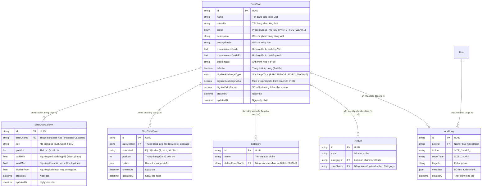

# 📖 Tài liệu Nghiệp vụ & Kiến trúc Cơ sở Dữ liệu — Phân hệ Bảng Size Mẫu (Size Charts)

> **Dự án:** Thương mại điện tử Áo Dài cao cấp — **Thiên Canh**  
> **Khu vực:** Quản trị nội bộ (`apps/web` — Admin Portal)  
> **Đường dẫn module:** `apps/web/src/features/admin/modules/size-charts`  
> **Đường dẫn router:** `/admin/catalog/size-charts` và `/admin/catalog/size-charts/[id]`  
> **Quyền hạn truy cập (`Permission`):** `MANAGE_INVENTORY` (hoặc vai trò `ADMIN` / Super Admin)  
> **Ngày cập nhật:** 18/11/2026  

---

## 1. Tổng quan Nghiệp vụ Phân hệ Bảng Size Mẫu

Trong ngành may đo và thời trang Áo Dài truyền thống của tiệm **Thiên Canh**, việc chọn size không chỉ đơn thuần là phân loại S, M, L mà là sự cân đối tỉ mỉ giữa các số đo cơ thể (ngực, eo, mông, hạ ngực, dài áo, vòng nách, bắp tay...). Khác với các hệ thống thương mại điện tử thông thường chỉ tải lên hình ảnh bảng size tĩnh để khách tự xem và tự suy đoán, **Thiên Canh xây dựng hệ thống Bảng size mẫu (Size Charts) bằng dữ liệu số có cấu trúc (Structured Numerical Data)**:

1. **Dữ liệu số thông minh thay cho hình ảnh tĩnh**: Mỗi bảng size là một ma trận dữ liệu số thực tế (khoảng `[min, max]` của từng thông số). Nhờ đó, hệ thống có thể lập trình tự động so khớp số đo của khách, cảnh báo vòng nào bị chật, gợi ý size may sẵn tối ưu hoặc chuyển sang chế độ may đo thủ công.
2. **Kế thừa & Phân tầng linh hoạt (Hierarchy of Sizing)**:
   - **Bảng size loại sản phẩm (`Category.defaultSizeChartId`)**: Gắn làm bảng quy chuẩn mặc định cho toàn bộ sản phẩm thuộc loại đó (ví dụ: *Bảng size Áo Dài Nữ Dáng Chuẩn* gắn cho loại *Áo dài truyền thống*).
   - **Bảng size riêng của sản phẩm (`Product.sizeChartId`)**: Áp dụng riêng cho các thiết kế có phom dáng cá biệt (phom suông rộng, áo dài dạ tiệc ôm sát...). Khi trường này `null`, sản phẩm tự động thừa hưởng bảng size của loại sản phẩm cha.
   - **Nhóm gốc không có bảng size**: 5 nhóm gốc cố định (`AO_DAI`, `PANTS`, `ACCESSORY`, `FOOTWEAR`, `MATERIAL`) không chứa bảng size (server luôn ép `null`).
3. **Phân định nhóm hàng áp dụng (`RELEVANT_GROUPS`)**:
   - `AO_DAI` (Áo dài): Bảng size đo theo cơ thể (`BODY`), đầy đủ các thông số từ 3 vòng chính đến vòng nách, bắp tay, dài tay, dài áo.
   - `PANTS` (Quần): Bảng size đo theo thân dưới (eo, mông, đùi, dài quần, ống quần).
   - `FOOTWEAR` (Giày guốc): Bảng size đo theo chiều dài bàn chân (`FOOT`).
   - `ACCESSORY` (Phụ kiện) & `MATERIAL` (Nguyên liệu vải): Không sử dụng bảng size (`sizing: NONE`).
4. **Tích hợp Nhận diện Bigsize & Tính Phụ phí Tự động**:
   - Định nghĩa ngưỡng ngoại cỡ (`bigsizeFrom`) cho từng cột thông số.
   - Khi khách may đo vượt ngưỡng bigsize ở bất kỳ thông số nào, hệ thống tự động nhận diện đơn hàng Bigsize, cộng phụ phí theo cấu hình (% hoặc tiền cố định VND) và thông báo số mét vải phát sinh cho xưởng may.

---

## 2. Mô hình Cơ sở Dữ liệu & Mối quan hệ (Prisma Database Models)



### Chi tiết các Bảng & Ràng buộc Toàn vẹn

### 2.1. Bảng `SizeChart` (Bảng size mẫu)
- **Khóa chính**: `id` (`UUID`).
- **Phân loại nhóm hàng (`group`)**:
  - Thuộc enum `ProductGroup`: Chỉ chấp nhận các nhóm hàng có áp dụng size (`AO_DAI`, `PANTS`, `FOOTWEAR`).
- **Cấu hình Phụ phí Bigsize**:
  - `bigsizeSurchargeType`: Enum `SurchargeType` (`PERCENTAGE` | `FIXED_AMOUNT`) hoặc `null`.
  - `bigsizeSurchargeValue`: Kiểu `Decimal(12, 2)`. Lưu % nếu là `PERCENTAGE` (tối đa 100), hoặc số tiền VND nếu là `FIXED_AMOUNT`.
  - `bigsizeExtraFabric`: Kiểu `Decimal(6, 2)`. Số mét vải may phát sinh dành cho xưởng may chuẩn bị vật tư.
- **Quan hệ & Xóa dữ liệu**:
  - `categories`: Danh sách các loại sản phẩm đang dùng bảng size này làm mặc định (`defaultSizeChartId`).
  - `products`: Danh sách các sản phẩm đang gắn riêng bảng size này (`sizeChartId`).
  - **Ràng buộc an toàn**: Khi bảng size đang có sản phẩm hoặc loại sản phẩm sử dụng (`productCount > 0` hoặc `categoryCount > 0`), **tuyệt đối không được xóa** (`SIZE_CHART_IN_USE`).
- **Chỉ mục tối ưu hóa (`@@index([group, isActive])`)**: Tối ưu hóa truy vấn lọc theo nhóm hàng và trạng thái áp dụng trên cả Admin lẫn Storefront.

### 2.2. Bảng `SizeChartColumn` (Cột thông số đo đạc)
- **Khóa chính**: `id` (`UUID`).
- **Khóa ngoại (`sizeChartId`)**: Trỏ về `SizeChart.id` với `onDelete: Cascade` (khi xóa bảng size, toàn bộ cấu hình cột tự động được dọn dẹp).
- **Mã thông số (`key`)**: Thuộc danh mục hằng số `MEASUREMENT_KEYS` từ `@repo/shared/sizing` (ví dụ: `height`, `weight`, `bust`, `waist`, `hips`, `shoulder`, `armpit`, `upperArm`, `armLength`, `shirtLength`, `footLength`...).
- **Ràng buộc duy nhất tổng hợp (`@@unique([sizeChartId, key])`)**: Trong một bảng size, mỗi thông số đo chỉ xuất hiện đúng một lần.
- **Ngưỡng kiểm tra tính hợp lệ (`validMin`, `validMax`)**:
  - Giúp bắt lỗi gõ nhầm đơn vị của khách hàng hoặc nhân viên (ví dụ: vòng eo gõ nhầm `650` cm thay vì `65` cm).
- **Ngưỡng ngoại cỡ (`bigsizeFrom`)**: Mức số đo tối đa của phom áo chuẩn. Vượt qua ngưỡng này trong đơn may đo sẽ tự động kích hoạt phụ phí bigsize.

### 2.3. Bảng `SizeChartRow` (Hàng kích cỡ cụ thể)
- **Khóa chính**: `id` (`UUID`).
- **Khóa ngoại (`sizeChartId`)**: Trỏ về `SizeChart.id` với `onDelete: Cascade`.
- **Ký hiệu kích cỡ (`sizeLabel`)**: Chuỗi ký tự định danh size (ví dụ: `XS`, `S`, `M`, `L`, `XL`, `XXL`, `38`, `39`, `2-3T`...). Trùng khớp với ký hiệu size của SKU sản phẩm.
- **Ràng buộc duy nhất tổng hợp (`@@unique([sizeChartId, sizeLabel])`)**: Trong cùng một bảng size, không được phép có hai hàng trùng ký hiệu size.
- **Ma trận giá trị (`values` JSON)**:
  - Lưu trữ dưới dạng Object có cấu trúc: `Partial<Record<MeasurementKey, { min: number | null, max: number | null }>>`.
  - Mỗi ô đại diện cho một khoảng số đo phù hợp của size đó (ví dụ: Size S có `bust: { min: 82, max: 86 }`, `waist: { min: 64, max: 68 }`).

---

## 3. Quy chuẩn & Thuật toán Nghiệp vụ Chi tiết

### 3.1. Thuật toán Gợi ý Size Thông minh trên Storefront (`suggestSize`)

Hệ thống cung cấp thuật toán chấm điểm độ lệch và tư vấn kích cỡ tự động dựa trên số đo thực tế khách hàng nhập:

```text
Khách hàng nhập số đo ────► validateMeasurements ───[Có lỗi]───► Báo lỗi gõ nhầm (BELOW_MIN / ABOVE_MAX)
                                   │
                               [Hợp lệ]
                                   ▼
                             detectBigsize ────[Vượt ngưỡng]────► recommendCustom: true, status: NO_FIT
                                   │
                               [Không bigsize]
                                   ▼
                              suggestSize
                                   │
                    ┌──────────────┴──────────────┐
                    ▼                             ▼
             Vừa vặn (FIT)             Hơi kích sát vòng (TIGHT)
        (Tất cả số đo nằm trong          (Có vòng cách max < 1cm,
           khoảng [min, max])            gợi ý kèm size kế tiếp)
```

#### Quy tắc chấm điểm (Scoring Algorithm):
1. **Phân loại thông số đo**:
   - **Thông số quyết định (Hard Measurements)**: Các vòng cơ thể (`bust`, `waist`, `hips`, `shoulder`, `armpit`...) có trọng số $\text{weight} = 1.0$.
   - **Thông số mềm (Soft Measurements)**: Chiều cao (`height`), cân nặng (`weight`), độ tuổi (`age`) chỉ mang tính tham khảo phom dáng, có trọng số $\text{weight} = 0.5$.
2. **Công thức tính độ lệch điểm số**:
   - Với mỗi thông số $k$ có giá trị khách nhập $v$, đối chiếu với khoảng $[min, max]$ của hàng size:
     $$\text{width} = \max(1, max - min)$$
     - Nếu $v > max$: $\text{score} += \frac{v - max}{\text{width}} \times \text{weight}$ (Ghi nhận vòng bị chật `tightKeys`).
     - Nếu $v < min$: $\text{score} += \frac{min - v}{\text{width}} \times \text{weight}$ (Ghi nhận vòng bị rộng `looseKeys`).
     - Nếu $max - v < 1\text{ cm}$ (chạm sát ngưỡng tối đa): Ghi nhận là vòng chật nhẹ.
3. **Đánh giá kết quả (`SizeSuggestion`)**:
   - Nếu $v - max > 2\text{ cm}$ ở bất kỳ thông số quyết định nào $\rightarrow$ Đánh dấu `hardMiss = true` $\rightarrow$ Kết luận `status: "NO_FIT"`, khuyến nghị chuyển sang may đo (`recommendCustom: true`).
   - Nếu có thông số bị sát $\rightarrow$ Kết luận `status: "TIGHT"`, trả về `sizeLabel`, danh sách `tightKeys` và size lớn hơn kế tiếp `nextSizeLabel`.
   - Nếu toàn bộ nằm trong khoảng lý tưởng $\rightarrow$ Kết luận `status: "FIT"`.

---

### 3.2. Cơ chế Bigsize, Phụ phí & Chuẩn bị Vải Xưởng (`detectBigsize`)

Trong may đo Áo Dài, khổ vải dệt truyền thống thường là $1.1\text{ m} - 1.5\text{ m}$. Khi khách hàng có số đo lớn (vòng ngực $\ge 98\text{ cm}$, mông $\ge 102\text{ cm}$, bắp tay lớn...), xưởng may bắt buộc phải nối tà, thay đổi sơ đồ giác mẫu và tiêu tốn nhiều vải hơn:

1. **Nhận diện Bigsize đa điểm**:
   - Mỗi cột thông số có thể khai báo một ngưỡng `bigsizeFrom`.
   - Chỉ cần **MỘT** thông số đo vượt ngưỡng (ví dụ khách chỉ có vòng 1 lớn hoặc bắp tay lớn), đơn hàng lập tức được xếp vào diện đơn **Bigsize**.
2. **Tính toán Phụ phí Bigsize**:
   - **Theo phần trăm (`PERCENTAGE`)**: Tính thêm theo % giá trị gốc của áo (ví dụ $+15\%$).
   - **Theo số tiền cố định (`FIXED_AMOUNT`)**: Cộng thêm một khoản tiền chi phí công và vải (ví dụ $+200.000\text{ đ}$).
   - **Nguyên tắc bảo mật**: Server luôn tự tính lại phụ phí bigsize từ dữ liệu DB, không tin tưởng giá trị gửi từ trình duyệt client.
3. **Dự trù vải xưởng may (`bigsizeExtraFabric`)**:
   - Khai báo số mét vải phát sinh (ví dụ $+0.5\text{ m}$). Thông tin này tự động truyền sang phiếu sản xuất xưởng may (`modules/tailoring`) để thợ cắt chuẩn bị đủ nguyên liệu trước khi ra rập.

---

### 3.3. Bảng Kiểm tra Ngưỡng Hợp Lệ Mặc Định (`DEFAULT_VALID_RANGE`)

Hệ thống áp dụng dải ngưỡng thực tế cho từng thông số nhằm loại trừ lỗi nhập liệu bất thường:

| Mã thông số (`MeasurementKey`) | Tên thông số | Đơn vị | Ngưỡng hợp lệ (`[validMin, validMax]`) |
| :--- | :--- | :--- | :--- |
| `height` | Chiều cao | cm | $80 - 200\text{ cm}$ |
| `weight` | Cân nặng | kg | $10 - 150\text{ kg}$ |
| `age` | Độ tuổi | tuổi | $1 - 100\text{ tuổi}$ |
| `bust` | Vòng ngực | cm | $50 - 150\text{ cm}$ |
| `waist` | Vòng eo | cm | $40 - 140\text{ cm}$ |
| `hips` | Vòng mông | cm | $50 - 160\text{ cm}$ |
| `shoulder` | Rộng vai | cm | $20 - 60\text{ cm}$ |
| `armpit` | Vòng nách | cm | $20 - 60\text{ cm}$ |
| `upperArm` | Vòng bắp tay | cm | $15 - 60\text{ cm}$ |
| `armLength` | Dài tay | cm | $20 - 80\text{ cm}$ |
| `shirtLength` | Dài áo | cm | $50 - 160\text{ cm}$ |
| `neck` | Vòng cổ | cm | $20 - 50\text{ cm}$ |
| `thigh` | Vòng đùi | cm | $30 - 90\text{ cm}$ |
| `pantsLength` | Dài quần | cm | $50 - 130\text{ cm}$ |
| `legOpening` | Ống quần | cm | $20 - 80\text{ cm}$ |
| `footLength` | Chiều dài bàn chân | cm | $18 - 32\text{ cm}$ |

---

### 3.4. Nghiệp vụ Trình Soạn Thảo Lưới Số Đo (`SizeChartGrid`)

Trình biên tập lưới số đo được thiết kế theo phong cách bảng tính chuyên dụng (Spreadsheet-like), tích hợp các tiện ích tăng tốc độ nhập liệu:

1. **Dán vùng dữ liệu từ Excel / Google Sheets (`applyPastedGrid`)**:
   - Cho phép thợ may sao chép vùng dữ liệu từ bảng tính nội bộ và dán thẳng vào trình soạn.
   - Hỗ trợ đa dạng định dạng chuỗi: `82-86`, `82 – 86`, `82,5`, `82` (tự hiểu $min = max = 82$).
   - Tự động bổ sung các hàng mới nếu vùng dữ liệu dán vượt quá số hàng hiện tại của bảng (tối đa `MAX_SIZE_CHART_ROWS = 30`).
2. **Tự động nội suy bước nhảy hàng mới (`createNextRow`)**:
   - Khi bảng đã có $\ge 2$ hàng (ví dụ hàng S và hàng M), khi bấm "Thêm hàng size", hệ thống tự động tính độ tăng số đo giữa 2 hàng cuối và điền sẵn cho hàng mới (ví dụ S $\rightarrow$ M tăng 4cm ngực thì L tự động cộng 4cm).
   - Tự động gợi ý ký hiệu size tiếp theo (`nextSizeLabel`) dựa trên preset chuẩn (`XS \rightarrow S \rightarrow M \rightarrow L \rightarrow XL \rightarrow XXL...`).
3. **Kiểm tra chéo thời gian thực (`collectGridIssues` & `refineSizeChartGrid`)**:
   - Kiểm tra trùng lặp thông số cột hoặc trùng lặp ký hiệu size.
   - Bắt lỗi logic ô số đo: $min > max$ hoặc giá trị nằm ngoài khoảng $[validMin, validMax]$ của cột.
   - Khóa nút "Lưu bảng size" và hiển thị tổng số lỗi để hướng dẫn nhân viên điều chỉnh.

---

### 3.5. Ràng buộc Vòng Đời & An Toàn Dữ Liệu

1. **Trạng thái khởi tạo**: Bảng size mới tạo luôn ở trạng thái chưa áp dụng (`isActive = false`) để tránh việc hiển thị bảng rỗng chưa có số liệu ra Storefront.
2. **Điều kiện kích hoạt (`toggleSizeChartAction`)**: Bắt buộc bảng size phải có ít nhất 1 hàng kích cỡ mới được phép bật áp dụng (`SIZE_CHART_EMPTY`).
3. **Khóa nhóm hàng (`SIZE_CHART_GROUP_LOCKED`)**: Khi bảng size đã được gắn cho ít nhất một loại sản phẩm (`categoryCount > 0`), không thể thay đổi nhóm hàng `group` (tránh việc gán nhầm bảng size áo dài cho quần hoặc guốc).
4. **Quy tắc chặn xóa tuyệt đối (`SIZE_CHART_IN_USE`)**:
   - Khi bảng size đang có loại sản phẩm hoặc sản phẩm sử dụng (`productCount > 0` hoặc `categoryCount > 0`), Server Action sẽ chặn thao tác xóa và trả mã lỗi `SIZE_CHART_IN_USE`.
5. **Nhân bản nhanh (`duplicateSizeChartAction`)**:
   - Cho phép sao chép nguyên vẹn một bảng size mẫu hiện có (toàn bộ cột, hàng, ngưỡng bigsize, phụ phí) thành một bản sao nháp (`isActive = false`) mang tên `... (bản sao)` để thợ may tinh chỉnh phom dáng mới nhanh chóng.

---

## 4. Kiến trúc Giao diện Người dùng (UI / UX Architecture)

### 4.1. Màn hình Danh sách Bảng Size Mẫu (`SizeChartsBoard`)

```text
┌────────────────────────────────────────────────────────────────────────────────────────┐
│ [Icon Ruler] Bảng size mẫu                                         [+ Thêm bảng size]  │
│ Danh sách quy chuẩn kích cỡ may sẵn và may đo theo từng nhóm hàng                      │
├────────────────────────────────────────────────────────────────────────────────────────┤
│ [Nhóm hàng: Tất cả ▼]  [Trạng thái: Tất cả ▼]  [Sử dụng: Tất cả ▼]  [🔍 Tìm kiếm...]   │
├────────────────────────────────────────────────────────────────────────────────────────┤
│ TÊN & NHÓM HÀNG    │ DẢI SIZE          │ THÔNG SỐ ĐO       │ BIGSIZE │ SỬ DỤNG  │ T.THÁI │ ⋯ │
├────────────────────┼───────────────────┼───────────────────┼─────────┼──────────┼────────┼───┤
│ Áo Dài Nữ Chuẩn    │ XS · S · M · L ·  │ 10 thông số       │ ≥ 98cm  │ 12 SP    │ Đang áp│ ⋯ │
│ Áo dài (Cơ thể)    │ XL · XXL (6 size) │ (Ngực, Eo, Mông...)│ +15%    │ 2 loại   │ dụng   │   │
├────────────────────┼───────────────────┼───────────────────┼─────────┼──────────┼────────┼───┤
│ Quần Ống Suông     │ S · M · L · XL    │ 5 thông số        │ —       │ 4 SP     │ Đang áp│ ⋯ │
│ Quần (Cơ thể)      │ (4 size)          │ (Eo, Mông, Đùi...)│         │ 1 loại   │ dụng   │   │
└────────────────────┴───────────────────┴───────────────────┴─────────┴──────────┴────────┴───┘
```

- **Bộ lọc 3 chiều trực quan**:
  - `groupFilter`: Lọc theo nhóm hàng (`AO_DAI`, `PANTS`, `FOOTWEAR`).
  - `statusFilter`: Lọc theo trạng thái (`ACTIVE`, `INACTIVE`).
  - `usageFilter`: Lọc theo phạm vi liên kết (`IN_USE` - Đang dùng, `UNUSED` - Chưa dùng, `BIGSIZE` - Có cấu hình ngoại cỡ, `EMPTY` - Chưa nhập lưới số đo).
- **Tìm kiếm thông minh**: Tìm theo tên tiếng Việt/tiếng Anh, ký hiệu size (`M`, `XL`), hoặc tên thông số đo (`ngực`, `eo`, `bust`...).

---

### 4.2. Màn hình Chi tiết Bảng Size (`SizeChartDetail`)

Được thiết kế theo nguyên tắc **CHỈ XEM (Read-only)**, nội dung tự động hiển thị theo ngôn ngữ quản trị (`vi` hoặc `en`). Mọi thao tác biên tập được gom gọn trong menu góc trên:

1. **Khối Thông tin chung**:
   - Ghi chú phom dáng thiết kế (`description`).
   - Hướng dẫn tự đo số đo cơ thể (`measurementGuide`) kèm ảnh trực quan (`guideImage`).
   - Cấu hình Phụ phí Bigsize: Loại phụ phí, mức phụ phí và danh sách các thông số vượt ngưỡng ngoại cỡ.
2. **Khối Lưới Bảng Size (`SizeChartTable`)**:
   - Hiển thị ma trận kích cỡ: Cột đầu cố định ký hiệu size, các cột tiếp theo là khoảng số đo `min – max`. Thành phần này được dùng chung với màn hình chi tiết loại sản phẩm.
3. **Các Hộp thoại Thao tác (Dialogs)**:
   - `SizeChartInfoDialog`: Dialog tạo mới hoặc sửa thông tin chung (tên, nhóm hàng, mô tả, hướng dẫn đo, phụ phí bigsize) có công tắc chuyển ngữ VI/EN (`AdminLangSwitch`).
   - `SizeChartGridDialog`: Dialog toàn màn hình (`size="5xl"`) chứa bộ soạn thảo ma trận `SizeChartGrid`.

---

## 5. Cấu trúc Thư mục & Phân bổ Trách nhiệm

```text
apps/web/src/features/admin/modules/size-charts/
├── actions/
│   └── sizeCharts.actions.ts         # Server Actions: mutate dữ liệu, revalidate, audit log
├── components/
│   ├── detail/
│   │   ├── SizeChartDetail.tsx       # Màn hình chi tiết bảng size (chỉ xem, bố cục tinh gọn)
│   │   └── SizeChartGridDialog.tsx   # Dialog nhập/sửa lưới số đo ma trận
│   ├── editor/
│   │   └── SizeChartGrid.tsx         # Bảng tính nhập số đo (hỗ trợ dán Excel, nội suy hàng)
│   ├── list/
│   │   └── SizeChartsBoard.tsx       # Bảng điều khiển danh sách bảng size, lọc 3 chiều
│   └── shared/
│   │   ├── SizeChartInfoDialog.tsx   # Dialog tạo/sửa thông tin chung bảng size
│   │   └── SizeChartTable.tsx        # Bảng dữ liệu size chỉ xem dùng chung
├── queries/
│   └── sizeCharts.queries.ts         # Query đọc Prisma: danh sách, chi tiết, đếm độ phủ sản phẩm
├── schemas/
│   └── sizeCharts.schemas.ts         # Zod schemas cho thông tin bảng size và phụ phí
├── types/
│   └── sizeCharts.types.ts           # Type definitions (AdminSizeChartDetail, ListItem...)
├── utils/
│   ├── sizeChartData.ts              # Xử lý parse JSON values, formatRange, parseNumberInput
│   ├── sizeChartGrid.ts              # Thuật toán dán Excel TSV, nội suy hàng, kiểm tra lỗi ô
│   ├── sizeChartGridValidation.ts    # Zod validation logic cho ma trận lưới số đo
│   ├── sizeChartPresets.ts           # Presets ký hiệu size, dải ngưỡng hợp lệ mặc định
│   └── sizeChartStarter.ts           # Khởi tạo lưới số đo mặc định theo nhóm hàng
└── index.ts                          # Barrel export duy nhất của feature module
```

---

## 6. Danh mục Mã Phản hồi & Mã Lỗi Nghiệp vụ

Toàn bộ phản hồi từ Server Action tuân thủ chuẩn hóa mã KEY viết hoa (`UPPER_SNAKE_CASE`), đồng bộ với hệ thống thông điệp đa ngữ:

| Mã phản hồi / Lỗi | Phân loại | Ý nghĩa nghiệp vụ |
| :--- | :--- | :--- |
| `SIZE_CHART_CREATED` | Audit Log | Tạo mới bảng size thành công |
| `SIZE_CHART_UPDATED` | Audit Log | Cập nhật thông tin hoặc lưới số đo bảng size |
| `SIZE_CHART_DUPLICATED` | Audit Log | Nhân bản bảng size thành công |
| `SIZE_CHART_ACTIVATED` | Audit Log | Kích hoạt áp dụng bảng size |
| `SIZE_CHART_DEACTIVATED` | Audit Log | Ngừng áp dụng bảng size |
| `SIZE_CHART_DELETED` | Audit Log | Xóa vĩnh viễn bảng size thành công |
| `SIZE_CHART_NAME_REQUIRED` | Validation Error | Tên bảng size không được để trống |
| `SIZE_LABEL_REQUIRED` | Validation Error | Ký hiệu size không được để trống ở bất kỳ hàng nào |
| `SIZE_LABEL_DUPLICATE` | Validation Error | Bị trùng lặp ký hiệu size giữa các hàng trong bảng |
| `SIZE_CHART_COLUMN_DUPLICATE` | Validation Error | Bị trùng lặp thông số đo giữa các cột trong bảng |
| `SIZE_CHART_RANGE_INVALID` | Validation Error | Giá trị số nhỏ nhất đang lớn hơn số lớn nhất ($min > max$) |
| `SIZE_CHART_VALUE_OUT_OF_RANGE` | Validation Error | Số đo nằm ngoài ngưỡng hợp lệ của cột ($< validMin$ hoặc $> validMax$) |
| `SIZE_CHART_SURCHARGE_INVALID` | Validation Error | Mức phụ phí bigsize không hợp lệ (phần trăm $> 100\%$ hoặc $\le 0$) |
| `SIZE_CHART_NOT_FOUND` | Business Error | Không tìm thấy bảng size trong hệ thống |
| `SIZE_CHART_GROUP_LOCKED` | Business Error | **Bảng size đang gắn cho loại sản phẩm, không được đổi nhóm hàng** |
| `SIZE_CHART_EMPTY` | Business Error | **Bảng size cần ít nhất một hàng kích cỡ trước khi áp dụng** |
| `SIZE_CHART_IN_USE` | Business Error | **Bảng size đang được sản phẩm / loại sản phẩm sử dụng, cấm xóa** |
| `SIZE_CHART_CREATE_FAILED` | System Error | Lỗi hệ thống khi khởi tạo bảng size |
| `SIZE_CHART_UPDATE_FAILED` | System Error | Lỗi hệ thống khi lưu bảng size |
| `SIZE_CHART_DELETE_FAILED` | System Error | Lỗi hệ thống khi xóa bảng size |
| `CATEGORY_SIZE_CHART_GROUP_MISMATCH` | Business Error | Bảng size gán cho loại sản phẩm không cùng nhóm hàng |
| `CATEGORY_SIZE_CHART_REQUIRED` | Business Error | Vui lòng nhập đủ số đo cho bảng size riêng của loại sản phẩm |
